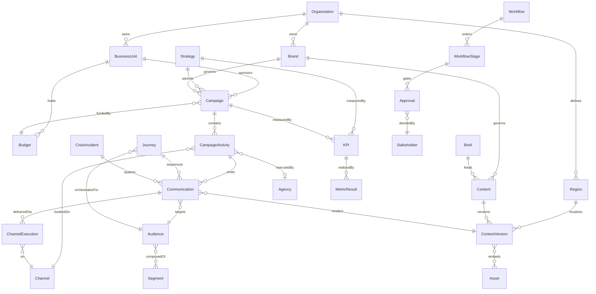
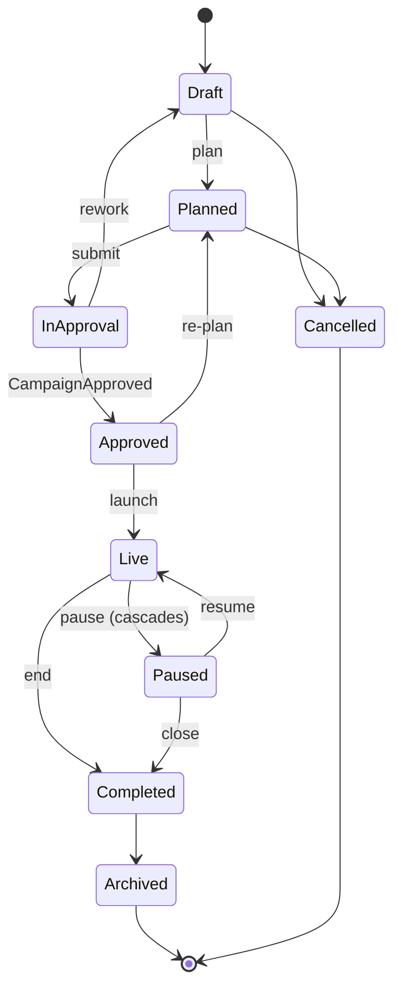
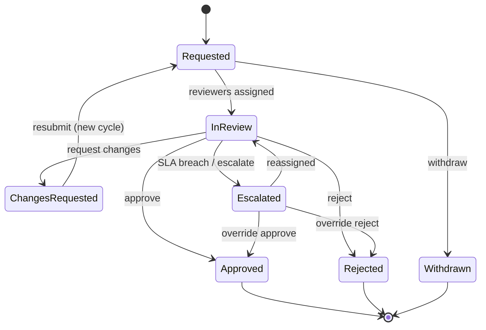

# MarComm — Phase 0 Product Blueprint

**Enterprise Communication Operating System · new app at `ui/marcomm` · NST design system**

*Produced 13 Aug 2026 by a multi-agent discovery + authoring workflow: 2 deep repository explorers, 2 independent convention-discovery agents, 8 parallel blueprint authors, and 1 adversarial consistency verifier whose 18 findings are resolved in this document (see Consistency Resolutions). No code has been written — this is the pre-implementation blueprint required before Phase 1.*

---

## Part 1 — Existing Architecture Assessment

The suite at `poc-playground/ui/` holds ~60 sibling apps. Three distinct stack lineages exist among the NST-themed apps:

| | `ui/ran` (flagship) | `ui/governance` | `ui/controls` |
|---|---|---|---|
| Origin | Hand-built | Figma Make export | Lovable export |
| React / build | React 19, Vite 8, TS 6 | React 18.3 (pinned), Vite 6, no TS | React 18.3, Vite 5 + SWC, TS 5.8 |
| Styling | **Ant Design 5** + CSS-var token layer (no Tailwind) | Tailwind **v4** (`@theme` in CSS) + full NST `vw-*`/`nst-*` class pack | Tailwind **v3.4** + classic shadcn HSL tokens |
| Components | antd + `shared/components/ux/` kit | 48 new-style shadcn (`data-slot`) files | 47 classic shadcn files + toast |
| Router | react-router-dom 7, `createBrowserRouter`, `basename:"/ran/"` | react-router 7, `Component:` routes | react-router-dom 6, `<BrowserRouter basename>` |
| Data | In-memory MockDB + faker seeds + JSON snapshots + TanStack Query | Module-const seeds + localStorage `DataStore.tsx` | Module-const typed seeds (~29k lines), TanStack Query, **no persistence** |
| Quality tooling | ESLint 10, tsc build | none (no lint, no TS, dead MUI deps) | ESLint 9, **vitest + Testing Library + Playwright** |
| RBAC | perspective/capability system | none | `rbac.ts` role × capability matrix + RoleProvider |
| Help system | — | hardcoded-JSX playbook modal | **data-driven** playbook/synopsis (`page-help.ts`, `getHelpForPath`) |

**Suite-wide conventions every app follows (marcomm must too):**
- Deploys under its own path: `base: "/<app>/"` in `vite.config.ts` **and** matching router `basename`; public assets resolved via `import.meta.env.BASE_URL`, never raw absolute paths.
- **Poppins** (Google Fonts link, weights 300–700), **NST black theme** (`#090909` primary via `data-theme="black"` remap), light mode as shipped default, `font-variant-numeric: tabular-nums` on metrics.
- Sidebar declared as a module-level `navItems`/`menuStructure` const; sidebar chrome is built but toggleable (a host shell can supply global chrome — governance/controls currently render theirs disabled).
- One coherent id-linked seed graph (`masterData.ts` pattern — byte-identical file shared by governance and controls): typed interfaces, string-array foreign keys, deterministic ids with human prefixes.
- Status displayed through semantic badge/chip components (`StatusBadge.tsx` / `vw-chip--*`), pastel bg + darker fg, sentence case.

**Baseline decision for `ui/marcomm` — fork the `controls` lineage, selectively upgraded:**
1. **`controls` template** for scaffold, TypeScript, Tailwind v3.4 + shadcn primitives, ESLint/vitest/Playwright, `rbac.ts`, and the data-driven playbook/synopsis system (`page-help.ts`). It is the only lineage with types + tests + a serializable help system.
2. **`governance`'s `DataStore.tsx`** ported for localStorage persistence with audit trail (its docblock declares it the intended cross-app convention, already shared with `ui/bess`); controls has no persistence.
3. **NST tokens re-synced from the canonical source** at `/Users/ent-0538/Downloads/NST_theme/NST Design System/` (governance's local copies of `colors.css`/`components.css` have drifted — do not copy them).
4. **Do not** adopt ran's Ant Design stack (heaviest migration surface, weakest fit with the shadcn primitives the two newest NST apps use) and do not mix shadcn generations (governance's `data-slot` components are incompatible with controls' classic ones).
5. Known divergences settled for marcomm: radius base `0.625rem` (controls), page background `--background: 210 20% 98%` (controls), border `220 13% 91%`.

## Part 2 — Existing Design-System Assessment

Canonical source: `/Users/ent-0538/Downloads/NST_theme/NST Design System/` — the absolute visual source of truth. Key facts:

- **Tokens**: full `--vw-color-*` primitive scales (`colors.css`); semantic layer (`colors_and_type.css`) — ink scale `#252525/#515151/#7C7C7C/#A8A8A8`, border `#E9E9E9`, surface white on `#F4F4F4`, pastel status chips (success `#D1FAE5/#047857`, danger `#FEE2E2/#B91C1C`, warn `#FFEDD5/#C2410C`, caution `#FEF9C5/#A16207`, info `#DBEAFE/#1D4EB8`, teal `#CFFAFE/#0E7490`); radius ladder 4/8/12/16/pill; 4-pt spacing grid; **borders (not shadows) on resting surfaces**, one shadow token for floating elements only.
- **Black theme** (`theme-black.css`, activated by `<html data-theme="black">`): primary `#090909`, hover `#595959`, press `#000000` — this is what the NST sibling apps ship.
- **Typography**: Poppins in the shipped apps (Inter in the raw kit); body 14px, h1 20px/500, weight-300 display classes for large metrics, weights 400/500/600 only, **sentence case everywhere**.
- **Component recipes** (`components.css`): `.nst-surface` (1px `#E9E9E9`, radius 8, no resting shadow), `.nst-input` (36px, radius 8, blue 3px focus ring), `.nst-table-card` (radius 12, header `#FCFCFC`, hover `#FAFAFA`, selected `#F0F7FE`, 12px/500 headers, 13px cells), `.nst-action-menu`, `.nst-textarea` with counter, Timeline, pill chips.
- **Hard rules**: no emoji, no gradients, no decorative illustration; never hardcode colors — tokens only; never invent new status tones; pastel chips only for status; icons carry meaning (Phosphor in the kit — marcomm uses **lucide-react** like both shadcn siblings, mapped 1:1 in role).

**How marcomm consumes it**: controls' `index.css` already remaps every shadcn token to NST-black values in HSL — copy it verbatim (it IS the NST theme in shadcn form), keep the Tailwind `hsl(var(--x))` mapping, load Poppins identically, and style status via a `StatusBadge` mirroring the pastel chip taxonomy. No new theme, no new tones, no re-invented components.

## Part 3 — Consistency Resolutions (binding decisions)

The adversarial verifier found 18 cross-section inconsistencies among the eight authored sections. All are resolved in the text that follows; where any residual wording conflicts, **these decisions win**:

1. **AI in MVP**: AI Copilot ships thin in MVP — draft-from-Brief + summarize behind the simulated `aiService`; everything beyond (next-best-action, predictions, agents) is Phase 2/Future.
2. **Phase mapping**: `[MVP]` = Must (increment 1); `[Phase 2]` = Should + Could (increments 2–3); `[Future]` = Future. Crisis Center and Governance & Compliance are `[Future]`; Administration is `[Phase 2]` (MVP ships its data seeded, no UI).
3. **Persona selection**: derived from the seeded-identity login picker; never a topbar role toggle. Topbar holds only the Brand/BU/Region scope switcher and notifications.
4. **One role vocabulary**: the ten personas + Platform Admin, used identically in navigation visibility, the access matrix, lifecycle transition tables, and workflow assignee rules.
5. **One classification enum**: `Public | Internal | Confidential | Restricted`; crisis visibility = named-Stakeholder access lists on `Restricted` records, not a fifth level.
6. **Channel-agnostic delivery**: Communication carries no `channelId`; delivery is one **ChannelExecution** per (Communication × Channel). ChannelExecution is a first-class entity in the catalog, ER diagram, and seed files.
7. **One lifecycle engine**: the **Workflow / WorkflowStage** entities ARE the configurable lifecycle definition; `LifecycleDefinition` is their authoring shape. No second engine.
8. **Approval**: engine-owned fixed 8-state machine (`Requested / In Review / Changes Requested / Escalated / Approved / Rejected / Withdrawn / Expired`) stored as `status`; Workflows configure where gates occur, not how gates behave.
9. **Content versioning**: lifecycle status lives on the **Content** head; **ContentVersion** is an immutable snapshot with no mutable status.
10. **Seed architecture**: the domain section's layout is canonical — `src/data/seed/{org,strategy,campaigns,communications,content,audience,governance,money,metrics}.ts` + `src/data/selectors/` modules + frozen `SeedDB` with `assertAllLinksResolve(db)`; the DataStore audit trail covers runtime mutations.
11. **MetricResult**: dimensioned shape `{kpiId?, metricKey, value, period, dimensions{...}}`; KPIs attach to Strategy, Campaign, CampaignActivity, or Journey. Provenance: seeded facts in MVP, event-derived from increment 3, same selector interface throughout.
12. **Journey**: versioned node/edge graph (trigger/audience/condition/wait/send/branch/exit) — the persisted shape from day one.
13. **Lifecycle applicability**: Workflows apply to Communication, Campaign, Content, Asset, CrisisIncident.
14. **Segment.size** and every other displayed number: computed by selectors, never stored literals.
15. **Analytics MVP**: Command Center KPI widgets only; the Performance page is increment 2.
16. **Module → nav mapping**: every one of the 22 modules resolves to a stated destination (table in the Navigation section) — no orphan modules.

---

# Part 4 — Product Vision, Positioning & Differentiation

# A. Product Vision

**MarComm is the enterprise Communication Operating System — a single connected environment where every communication an organization produces, internal or external, planned or crisis-driven, is conceived, governed, produced, delivered, and measured.** Today, enterprise communication is fragmented across marketing clouds, intranet tools, DAMs, agency email threads, and crisis war-rooms — each holding a disconnected slice of the truth. MarComm replaces that fragmentation with one operating system: an **Idea** becomes a **Strategy**, a Strategy spawns **Campaigns** and **Communications**, Campaigns decompose into **CampaignActivities** grounded in **Briefs**, Briefs drive **Content** and **ContentVersions** built from governed **Assets**, delivered across any **Channel** to precisely defined **Audiences** and **Segments**, orchestrated through configurable **Workflows** and **Approvals**, and closed out against **KPIs** and **MetricResults**. Nothing floats free: every record is a node in one relationship graph spanning **Organization**, **BusinessUnit**, **Brand**, and **Region**, so the answer to "what are we saying, to whom, where, why, and did it work?" is always one query away.

MarComm is channel-agnostic and AI-native by design. It does not privilege email over an all-hands, a press release over a paid social flight, or a product launch over a **CrisisIncident** — all are Communications moving through configurable lifecycles with the right **Stakeholders**, **Agencies**, **Budgets**, and **Policies** attached. AI operates as a first-class participant in the system, not a bolt-on: it drafts against Briefs, enforces brand and **Policy** compliance before Approval, predicts KPI outcomes from historical MetricResults, and accelerates crisis response from hours to minutes. The lifecycle is complete — ideation to outcome — with a full **AuditRecord** trail behind every decision, which is what makes MarComm an operating system rather than another tool in the stack.

# B. Market Positioning

| Category | Representative players | What they do well | Where they stop | What MarComm does instead |
|---|---|---|---|---|
| Marketing clouds / campaign management | Salesforce MC, Adobe, Braze | External Channel execution, Journey automation, Segment targeting | External-only; no internal/corporate/crisis comms; strategy and approval live outside the tool | Treats external Campaigns as one lifecycle among many, connected upstream to Idea/Strategy and downstream to MetricResults |
| Content operations / MRM | Optimizely CMP, Aprimo, Welcome | Brief-to-Content production workflow, calendars | Workflow ends at "published"; weak Audience/Channel/measurement linkage; no comms beyond marketing | Content and ContentVersion are graph nodes tied to Campaign, Audience, Channel, Approval, and MetricResult — production is a phase, not the product |
| DAM | Bynder, Aquia DAM, Canto | Asset storage, rights, versioning | Assets are inert files with no knowledge of where, why, or how well they were used | Asset usage is traced through Content → Channel → MetricResult, with Brand governance and Policy enforcement at point of use |
| Corporate/internal comms tools | Staffbase, Firstup, Poppulo | Employee Channel delivery, intranet publishing | Siloed from external marketing; no shared Audience model, Workflow engine, or Brand governance | Internal Communications run on the same Workflow, Approval, Audience, and KPI machinery as external — one system, one graph |
| Work management | Asana, Monday, Wrike | Generic task/Workflow tracking | Knows nothing about Briefs, Brands, Channels, Audiences, or outcomes; "campaign" is just a project name | Domain-native lifecycles where WorkflowStages understand what a Brief, Approval, or CrisisIncident actually is |

**The wedge:** every category above owns a fragment; none owns the connective tissue. MarComm occupies the layer enterprises currently improvise with spreadsheets, decks, and email — the system of record for *all* communication decisions and their outcomes. It does not out-deliver Braze on push notifications or out-store Bynder on files; it makes every delivery tool and repository legible, governed, and measurable from one graph. That is the position no incumbent can move into without abandoning its single-fragment architecture.

# C. Differentiation

1. **Unified internal + external + corporate + crisis comms.** One Audience model, one Workflow engine, one AuditRecord trail across all four domains — eliminating the message inconsistency and duplicated tooling that comes from running employee comms, marketing, PR, and crisis response in four disconnected systems.

2. **The communication knowledge graph.** Every entity — Idea through MetricResult — is linked, so impact analysis ("which Campaigns, Content, and Channels does this Brand refresh touch?") and outcome attribution ("which Strategy produced this KPI movement?") are native queries instead of quarterly archaeology projects.

3. **Configurable lifecycles, not hardcoded workflows.** Each Organization, BusinessUnit, and Brand defines its own WorkflowStages and Approval chains per communication type and Region; enterprises consolidate because the system adapts to their governance model rather than forcing a vendor's process onto legal, brand, and regional review realities.

4. **AI-native operations.** AI drafts Content from Briefs, scores Policy and brand compliance pre-Approval, recommends Segments and Channels from historical MetricResults, and summarizes Campaign performance — embedded in every lifecycle stage, compounding value from the graph in ways bolt-on copilots working from a single fragment cannot.

5. **Crisis acceleration.** A CrisisIncident instantly activates pre-approved holding statements, compressed Approval paths, Stakeholder trees, and multi-Channel simultaneous publishing — turning the highest-stakes, worst-tooled communication moment into the system's strongest capability.

6. **Brand governance at the point of work.** Brand rules, Policy checks, and approved Assets are enforced inside Content creation and Approval — not in a PDF guideline nobody opens — so multi-Brand, multi-Region enterprises get consistency without a central bottleneck team reviewing everything manually.

7. **Executive and stakeholder communications as a first-class lane.** Leadership messaging, board comms, and investor-facing Communications get their own confidential lifecycles, Stakeholder mapping, and Notification controls — the highest-sensitivity communication class finally leaves email threads and enters a governed, auditable system.

8. **Closed-loop measurement.** Every Communication carries KPIs at creation and reconciles against MetricResults after delivery, with Budget actuals tied to Campaign and Agency records — replacing "we published it" with "it worked, here's the evidence, and here's what it cost."

---

# Part 5 — Complete Module Map

# Complete Module Map

**Phasing legend:** `[MVP]` = the coherent thin slice (Idea → Campaign → Brief → Content → Approval → Calendar → Dashboard) plus the minimum org/AI scaffolding that slice needs — this equals the **Must** tier (increment 1) of the MVP boundary. `[Phase 2]` = broadens to full multi-channel, multi-audience CommOS — equals the **Should + Could** tiers (increments 2–3). `[Future]` = deep specialization once the core is proven — equals the **Future** tier. Every module reads/writes the shared relationship graph — no module owns private disconnected data.

---

## 1. Home / Command Center `[MVP]`
Personalized operational cockpit: everything needing my attention, across all Brands, BUs, and Regions.

- **My Work** — assigned WorkflowStage items, pending Approval queue, due Brief/Content tasks, one-click act.
- **Live Pulse** — active Campaign health tiles (KPI vs MetricResult), today's Calendar slice, Notification stream.
- **Command Palette** — global search across the graph (Campaign, Content, Asset, Stakeholder…), quick-create, jump-to.
- **Alerts & Signals** *(Phase 2 additions)* — CrisisIncident banners, anomaly detection, cross-Region rollups.

## 2. Ideation Hub `[MVP]`
Structured front door where raw Ideas are captured, scored, and promoted — nothing enters the system unlinked.

- **Idea Intake** — capture form (any Stakeholder), tagging to Brand/BusinessUnit/Region/Audience, duplicate detection.
- **Evaluation Board** — configurable scoring (impact/effort/strategic fit), kanban lifecycle (Draft → Scored → Approved → Promoted → Archived), voting/comments.
- **Promotion** — one-click convert Idea → Campaign or Idea → Communication with lineage preserved in the graph.
- **AI Ideation** *(thin in MVP)* — Copilot-generated Idea variants, clustering of similar Ideas, auto-scoring suggestions.

## 3. Strategy `[Phase 2]`
Codifies Strategy objects (annual/quarterly comms strategies per Brand/BU/Region) that Campaigns must ladder up to.

- **Strategy Canvas** — objectives, narratives, pillars, target Audiences, linked KPIs with targets.
- **Alignment Map** — visual graph of Strategy → Campaign → Communication linkage; orphan-campaign detection.
- **Planning Cycles** — versioned Strategy periods, mid-cycle revision with AuditRecord trail.

## 4. Campaigns `[MVP]`
The central workhorse: plan, run, and track Campaigns as the connective tissue of the graph.

- **Campaign Workspace** — overview (objectives, Brand/BusinessUnit/Region scope, linked Strategy/Idea lineage, Budget summary, KPI targets), configurable lifecycle driven by Workflow.
- **Activity Plan** — CampaignActivity breakdown (owner, dates, Channel, status), dependencies, rollup to Calendar.
- **Brief Management** — create Brief per Campaign/CampaignActivity, AI-drafted from Campaign context, routed through Approval.
- **Campaign List & Portfolio** — filterable across Brand/BU/Region/status, saved views, portfolio health (RAG).
- **Multi-market Orchestration** *(Phase 2)* — parent/child Campaigns, Region localization tracking, transcreation status.

## 5. Communications `[Phase 2]`
Manages standalone Communication records (announcements, memos, statements) that don't warrant a full Campaign — same rigor, lighter lifecycle.

- **Communication Composer** — typed Communication (internal/external/corporate/crisis), Audience + Channel targeting, linked Content.
- **Lifecycle & Routing** — configurable Workflow, Approval chain, scheduled send/publish to Calendar.
- **Message Registry** — searchable archive, reuse/clone, linkage to Campaign, CrisisIncident, or Event where applicable.

## 6. Content Studio `[MVP]`
Where all Content is created, versioned, and approved — AI-native from the first keystroke.

- **Editor & Composer** — Content authoring per format, driven by the parent Brief; Brand voice enforcement inline.
- **Versioning** — full ContentVersion history, side-by-side diff, restore, per-Channel/per-Region variants as linked versions.
- **Review & Approval** — annotated review, WorkflowStage routing, Approval capture with AuditRecord.
- **AI Assist** — draft-from-Brief, tone/length rewrites, variant generation per Channel/Audience, compliance pre-check *(thin in MVP: draft + rewrite)*.
- **Localization** *(Phase 2)* — Region-aware transcreation queues, language variant tracking.

## 7. Asset Library (DAM) `[Phase 2]`
Single source of truth for every Asset (image, video, doc, design file) with rights and usage intelligence. *(MVP ships basic Asset attach/store inside Content Studio; the full DAM is Phase 2.)*

- **Library & Search** — faceted browse by Brand/type/Campaign/tag, AI auto-tagging, visual similarity search.
- **Rights & Usage** — license/expiry metadata, usage tracking across Content and Channels, expiring-rights alerts.
- **Collections & Sharing** — curated sets per Campaign/Event/Agency, controlled external share links.

## 8. Audiences `[Phase 2]`
Models who we talk to: Audience definitions and reusable Segments shared by every module.

- **Audience Registry** — internal + external Audiences (employees, media, investors, customers) per Brand/BU/Region.
- **Segment Builder** — attribute/behavior rules composing Segments, size estimates, overlap analysis.
- **Insight Profiles** — AI-generated Audience summaries, preferred Channels, message-resonance history from MetricResult.

## 9. Channels & Orchestration `[Phase 2]`
Channel-agnostic delivery layer: registered Channels and multi-step Journeys sequencing Communications across them.

- **Channel Registry** — every owned/earned/paid/internal Channel with capabilities, formats, Audience reach, connection status.
- **Journey Designer** — visual Journey builder (steps, waits, branches) sequencing Content across Channels per Segment.
- **Dispatch & Scheduling** — publish/send orchestration, per-Channel adaptation of ContentVersion, delivery status back to the graph.

## 10. Calendar & Work Management `[MVP]`
The one calendar of everything, plus the task layer that runs the work.

- **Unified Calendar** — every Campaign, CampaignActivity, Communication, Event, and content milestone; filter by Brand/BU/Region/Channel; conflict and collision detection.
- **Work Board** — tasks generated from WorkflowStage assignments, kanban/list views, workload by Stakeholder.
- **Planning Views** *(Phase 2)* — quarter/annual Gantt, capacity planning, freeze windows.

## 11. Events `[Phase 2]`
Plans and executes Events as first-class graph citizens tied to Campaigns and Communications.

- **Event Workspace** — logistics, run-of-show, linked Budget, Stakeholder/speaker management, session planning.
- **Event Comms** — invitation/reminder/follow-up Communications generated and scheduled per Segment.
- **Post-Event** — attendance MetricResult capture, content harvest into Asset Library, ROI rollup to Campaign.

## 12. PR & Media `[Phase 2]`
External-relations engine: press operations, media relationships, and earned coverage.

- **Media Database** — journalist/outlet Stakeholder records, beat/relationship history, interaction log.
- **Press Operations** — press releases as Content through standard Approval, embargo management, distribution via Channels.
- **Coverage Tracking** — earned mentions as MetricResult, sentiment, share-of-voice vs competitors.

## 13. Internal Comms `[Phase 2]`
Purpose-built surface for employee communications riding the same Campaign/Communication/Content spine.

- **Employee Campaigns** — change/culture/leadership Campaigns targeted at internal Audiences and Segments (by BusinessUnit/Region).
- **Internal Channels** — intranet/email/chat/digital-signage Channel delivery, send-time optimization.
- **Engagement Analytics** — open/read/feedback MetricResult per Communication, pulse surveys.

## 14. Crisis Center `[Future]`
War-room for CrisisIncident response: pre-approved speed with full auditability.

- **Incident Management** — declare CrisisIncident (severity, scope, affected Brand/BU/Region), activation of response team Stakeholders.
- **Holding Statements** — pre-approved Content templates, expedited Workflow with compressed Approval, statement version control.
- **Situation Log** — timeline of every action/Communication as AuditRecord, stakeholder notification tree, post-incident review.

## 15. Executive Comms `[Future]`
Dedicated support for C-suite voices: speeches, thought leadership, executive social presence.

- **Executive Profiles** — per-leader platform, positions, engagement history, upcoming commitments.
- **Speech & Talking Points** — long-form Content with tight Approval chains, briefing books per Event/appearance.
- **Executive Channels** — personal social/byline Channel management, reputation MetricResult tracking.

## 16. Brand Center `[Phase 2]`
Governs Brand identity: the machine-readable brand system every module (and the AI Copilot) enforces.

- **Brand Portal** — per-Brand guidelines, voice/tone rules, visual identity, approved terminology, linked master Assets.
- **Brand Architecture** — Organization → BusinessUnit → Brand hierarchy management, sub-brand rules, Region adaptations.
- **Compliance Scoring** — AI brand-adherence checks on Content, violation flags routed to Workflow.

## 17. Budget & Finance `[Phase 2]`
Money layer: Budget planning and burn tracking connected to what the money actually produced.

- **Budget Planning** — Budget allocation by Organization/BusinessUnit/Brand/Region → Campaign → CampaignActivity.
- **Spend Tracking** — commitments/actuals (incl. Agency fees), variance alerts, reforecast.
- **ROI Linkage** — spend joined to MetricResult for cost-per-outcome across the graph.

## 18. Agencies & Vendors `[Future]`
Manages external Agency partners as governed participants in the workflow, not email attachments.

- **Agency Registry** — Agency records, scopes, rates, linked Stakeholder contacts, performance scorecards.
- **Collaboration Workspace** — scoped external access to assigned Brief/Content/Asset items, deliverable submission into Workflow.
- **Performance & Spend** — SLA tracking, quality ratings, Budget consumption per Agency.

## 19. Analytics & Attribution `[MVP]`
Closes the loop: every KPI target meets its MetricResult, from single Content piece to portfolio. *(MVP ships the Command Center's KPI/MetricResult widgets only; Campaign dashboards and the Performance page arrive in increment 2; attribution modeling is Phase 2.)*

- **Campaign Dashboards** — KPI vs MetricResult per Campaign, activity-level drilldown, RAG status.
- **KPI Framework** — KPI library, target-setting at Strategy/Campaign/Communication level, cascade rollups.
- **Attribution & Mix** *(Phase 2)* — cross-Channel attribution, Journey path analysis, Segment-level resonance.
- **Executive Reporting** *(Phase 2)* — auto-generated narrative reports, Board packs, cross-BU/Region comparisons.

## 20. AI Copilot `[MVP]`
The AI-native layer woven through every module — context-aware because it reads the same graph. *(MVP ships drafting + summarization; agents and predictions are Phase 2/Future.)*

- **Generate** — Brief-from-Campaign, Content-from-Brief, variant/rewrite per Channel/Audience/Brand voice.
- **Summarize & Answer** — natural-language Q&A over the graph ("what's blocking the Q3 launch?"), meeting-to-Brief, thread summarization.
- **Recommend** *(Phase 2)* — next-best-action, send-time and Channel suggestions, KPI anomaly explanations.
- **Agents** *(Future)* — autonomous localization, monitoring, and reporting agents operating under Policy guardrails.

## 21. Governance & Compliance `[Future]`
Policy, audit, and control plane over every action in the system. *(MVP embeds basic Approval + AuditRecord in Workflow; this module is the dedicated management surface.)*

- **Policy Engine** — Policy definitions (regulatory, disclosure, brand, AI-usage) bound to entity types, Regions, and WorkflowStages; automated pre-publish checks.
- **Approval Governance** — Approval matrix configuration, delegation, escalation SLAs, bottleneck analytics.
- **Audit & Records** — immutable AuditRecord explorer, retention rules, export for legal/regulatory review.

## 22. Administration `[Phase 2]`
System backbone: structure, people, and configuration everything else depends on. *(MVP ships org structure, users/roles, and Workflow definitions as **seeded data only** — the management surface itself is Phase 2.)*

- **Org Structure** — Organization, BusinessUnit, Brand, Region hierarchy management.
- **Users & Roles** — Stakeholder directory, role/permission assignment scoped by Brand/BU/Region.
- **Workflow Configuration** — lifecycle templates (Workflow + WorkflowStage definitions) per entity type, Approval chain setup.
- **Platform Settings** *(Phase 2)* — Channel connections, Notification rules, taxonomy/tag management, data retention.

---

### MVP slice in one sentence
An Idea is captured in the **Ideation Hub**, promoted to a **Campaign** with an AI-drafted **Brief**, turned into approved **Content** through **Content Studio**'s Workflow/Approval chain, scheduled on the unified **Calendar**, and measured on the **Command Center**'s KPI widgets — with **Home**, **AI Copilot** (draft/summarize via the simulated `aiService`), and seeded org/users/Workflow definitions as the supporting scaffold. Everything else deepens this spine; nothing replaces it.

---

# Part 6 — User Personas & Role Model

# User Personas & Role Model

MarComm serves ten personas across the communication lifecycle. Every persona is modeled as a **role** (capability set) plus **attribute scope** (which Organization / BusinessUnit / Brand / Region slices they can see). The demo app must feel like each persona's actual workday, not an admin console with a role dropdown.

## 1. Persona Definitions

### 1.1 CMO (Chief Marketing Officer)
| | |
|---|---|
| **Responsibilities** | Owns the Strategy portfolio; allocates Budget across BusinessUnits and Brands; accountable for KPI performance and brand health across all Regions |
| **Goals** | One trustworthy view of every Campaign and Communication in flight; prove marketing ROI; kill low-performing spend fast |
| **Top pains** | Fragmented reporting per channel/agency; no line of sight from Strategy → Campaign → MetricResult; surprises surfacing in exec meetings |
| **Permissions** | View everything org-wide (including confidential CrisisIncident summaries); approve Strategy, Budget, and tier-1 Campaigns; no content editing |
| **Primary screens** | Executive Command Center, Strategy portfolio, Budget rollup, KPI scorecards, Campaign portfolio heatmap |
| **Key actions** | Approve/reject Strategy and Budget; reallocate Budget; drill from KPI → MetricResult → Campaign; annotate priorities; escalate a CrisisIncident |

### 1.2 Campaign Manager
| | |
|---|---|
| **Responsibilities** | Plans and runs Campaigns end-to-end: Brief intake, CampaignActivity scheduling, Workflow orchestration, cross-Channel launch, performance follow-through |
| **Goals** | Launch on time and on Budget; keep every CampaignActivity and Approval unblocked; hit Campaign KPIs |
| **Top pains** | Chasing Approvals over email; Assets arriving late from Agency; no single timeline of dependencies; budget burn invisible until month-end |
| **Permissions** | Full edit on Campaigns/CampaignActivities/Briefs within assigned Brand+Region scope; request (not grant) Approvals; view Budget for owned Campaigns |
| **Primary screens** | Campaign workspace, Campaign calendar/timeline, Workflow board, Brief detail, Journey builder, Campaign KPI dashboard |
| **Key actions** | Create Campaign from Strategy; issue Brief; assign Content and Audience/Segments; advance WorkflowStages; route Approvals; launch to Channels; log Budget actuals |

### 1.3 Corporate Comms Manager
| | |
|---|---|
| **Responsibilities** | Corporate narrative, executive Communications, investor/regulatory messaging, CrisisIncident response leadership |
| **Goals** | Message consistency across Brands and Regions; sub-hour crisis response; protected confidential workstreams |
| **Top pains** | Leaks from over-broad access; crisis playbooks living in slide decks; no AuditRecord of who approved which statement |
| **Permissions** | Full edit on corporate-class Communications and CrisisIncidents (confidentiality-gated); approve corporate Content; admin over crisis Workflows |
| **Primary screens** | Corporate comms hub, CrisisIncident war room, Stakeholder map, holding-statement library, Approval queue |
| **Key actions** | Open/manage a CrisisIncident; publish holding statements; brief Stakeholders; run corporate Approval chains; freeze conflicting Campaign sends during a crisis |

### 1.4 Content Manager / Creator
| | |
|---|---|
| **Responsibilities** | Produces Content and ContentVersions against Briefs; manages Asset production; drives AI-assisted drafting and channel adaptation |
| **Goals** | Fewer revision cycles; clear Brief requirements; instant reuse of approved Assets |
| **Top pains** | Vague Briefs; feedback scattered across tools; re-creating existing Assets; losing version history |
| **Permissions** | Create/edit Content, ContentVersion, Asset within Brand scope; submit to Workflow; no approve rights; no Budget visibility |
| **Primary screens** | Content studio, Brief detail, Asset library, ContentVersion compare view, my Workflow queue |
| **Key actions** | Draft Content (AI-assisted) from Brief; create ContentVersions per Channel; attach Assets; submit for Approval; resolve reviewer comments |

### 1.5 Brand Manager
| | |
|---|---|
| **Responsibilities** | Guards Brand identity, voice, and Policy compliance across every Communication touching their Brand |
| **Goals** | Zero off-brand publications; consistent Brand expression across Regions and Agencies |
| **Top pains** | Off-brand Assets from Agencies; no enforcement point before publish; brand guidelines ignored because they live in a PDF |
| **Permissions** | View all activity in Brand scope across BUs/Regions; approve brand WorkflowStage; edit Brand guidelines and brand-level Policies |
| **Primary screens** | Brand hub, brand Approval queue, Asset library (brand view), brand health KPIs, Policy manager (brand rules) |
| **Key actions** | Approve/reject at brand review WorkflowStage; flag Policy violations; curate approved Asset collections; monitor brand KPI/MetricResults |

### 1.6 PR Manager
| | |
|---|---|
| **Responsibilities** | Media relations, press releases, journalist/analyst Stakeholder relationships, Event press coverage, external Agency (PR) coordination |
| **Goals** | Coordinated announcements across owned/earned channels; embargo discipline; measurable coverage |
| **Top pains** | Embargo breaks from uncoordinated Campaign sends; no shared Stakeholder (media) list; coverage results disconnected from effort |
| **Permissions** | Full edit on PR-class Communications, media Stakeholders, press Events; approve press Content; view related Campaigns |
| **Primary screens** | PR newsroom, press release Workflow, media Stakeholder CRM, Event hub, coverage MetricResult dashboard |
| **Key actions** | Draft/route press releases; manage embargo dates on Communications; pitch Stakeholders; link coverage MetricResults; coordinate with CrisisIncident comms |

### 1.7 Internal Comms Manager
| | |
|---|---|
| **Responsibilities** | Employee-facing Communications: leadership messages, change programs, town-hall Events, intranet/email/chat Channels |
| **Goals** | Reach and comprehension across Segments of employees; leadership messages land before rumors do |
| **Top pains** | No employee Audience segmentation; internal comms invisible in the campaign calendar (collision with external sends); no engagement measurement |
| **Permissions** | Full edit on internal-class Communications, employee Audiences/Segments, internal Events; approve internal Content; view external Campaign calendar |
| **Primary screens** | Internal comms hub, employee Audience/Segment builder, unified calendar (internal+external), internal Journey builder, engagement KPIs |
| **Key actions** | Plan internal Campaigns; segment employee Audiences by BusinessUnit/Region; schedule against external sends; publish to internal Channels; track open/engagement MetricResults |

### 1.8 Legal / Compliance Reviewer
| | |
|---|---|
| **Responsibilities** | Reviews Communications and Content against Policies (claims, disclosures, privacy, regulatory per Region); maintains the AuditRecord trail |
| **Goals** | Nothing non-compliant ships; reviews cleared inside SLA; defensible audit trail |
| **Top pains** | Review requests arriving without context; no Region-specific Policy engine; proving after the fact what was approved and when |
| **Permissions** | View all content pending review org-wide (incl. confidential when assigned); approve/reject legal WorkflowStage; edit Policies; read-only AuditRecords; no content creation |
| **Primary screens** | Compliance review queue, Policy manager, AuditRecord explorer, risk dashboard (violations by Brand/Region) |
| **Key actions** | Approve/reject/annotate at legal WorkflowStage; attach Policy citations to rejections; run AI pre-check against Policies; export AuditRecords |

### 1.9 Executive (non-marketing: CEO, CFO, BU heads)
| | |
|---|---|
| **Responsibilities** | Consumes performance and reputation signals; sponsors major Strategies; final voice in tier-1 CrisisIncidents |
| **Goals** | Five-minute answer to "how is our communication performing and what needs me"; no operational noise |
| **Top pains** | Dashboards built for marketers, not decisions; being pulled into detail; late crisis awareness |
| **Permissions** | Read-only across scoped BusinessUnits; approve only items explicitly routed to them (tier-1 Approvals, crisis statements); Notifications-driven |
| **Primary screens** | Executive digest, KPI scorecard, pending-my-Approval list, CrisisIncident status board |
| **Key actions** | Approve escalated items; comment on Strategy; acknowledge CrisisIncident briefings |

### 1.10 Agency User (external)
| | |
|---|---|
| **Responsibilities** | Executes assigned Briefs on behalf of an Agency: produces Content/ContentVersions/Assets, submits deliverables into Workflow |
| **Goals** | Unambiguous Briefs; single feedback channel; fast Approval turnaround |
| **Top pains** | Working from stale Assets; feedback via email screenshots; no visibility into where their deliverable sits in Workflow |
| **Permissions** | Hard-scoped to assigned Briefs/Campaigns only; create/edit own Content and Assets; submit to Workflow; no Audience, Budget, KPI, Policy, or crisis visibility; every action AuditRecord-logged |
| **Primary screens** | Agency portal (assigned Briefs), deliverable upload, ContentVersion feedback thread, own Workflow status |
| **Key actions** | Accept Brief; upload Asset/ContentVersion; respond to review comments; resubmit; track Approval status |

## 2. Role × Module Access Matrix

Legend: **V** view · **E** view+edit · **A** view+edit+approve · **★** admin (configure module) · **–** no access · **(s)** scope-limited beyond normal attribute scoping

| Module | CMO | Campaign Mgr | Corp Comms | Content Mgr | Brand Mgr | PR Mgr | Internal Comms | Legal/Compl. | Executive | Agency |
|---|---|---|---|---|---|---|---|---|---|---|
| Strategy & Planning (Strategy, Idea) | A | E | E | V | V | V | V | V | V(s) | – |
| Campaigns (Campaign, CampaignActivity, Brief) | A | ★ | E | V | V | V | E | V | V | V(s) |
| Content Studio (Content, ContentVersion) | V | E | A | ★ | A | A | A | A | – | E(s) |
| Asset Library (Asset) | V | E | E | ★ | A | E | E | V | – | E(s) |
| Audiences (Audience, Segment) | V | E | V | V | V | V | ★ | V | – | – |
| Channels & Journeys (Channel, Journey) | V | E | E | V | V | E | E | V | – | – |
| Workflow & Approvals (Workflow, WorkflowStage, Approval) | A | E | ★ | E | A | A | A | A | A(s) | E(s) |
| Corporate & PR (Communication, Stakeholder, Event) | V | V | ★ | E | V | ★ | E | A | V | – |
| Crisis (CrisisIncident) | V | – | ★ | – | V(s) | E | E | V | V | – |
| Budget | ★ | E(s) | V(s) | – | V(s) | V(s) | V(s) | – | V | – |
| Analytics (KPI, MetricResult) | ★ | E | V | V | V | V | V | V | V | – |
| Governance (Policy, AuditRecord) | V | V | E | V | E | V | V | ★ | V | – |
| Admin (Organization, BusinessUnit, Brand, Region, Agency, Notification config) | V | – | – | – | – | – | – | – | – | – |

*(A separate Platform Admin role holds ★ on Admin; it is an operator role, not a persona, and stays out of demo storylines.)*

## 3. Attribute-Based Scoping (ABAC over RBAC)

The matrix answers "what can this role do"; four attributes answer "on which records":

- **BusinessUnit** — every Campaign, Budget, Audience, and Communication carries a BusinessUnit; users hold one or more BU grants. Executive and CMO roles default to all-BU.
- **Brand** — Brand Managers, Content Managers, and Agencies are Brand-scoped; a multi-Brand Campaign requires an Approval from each Brand's brand WorkflowStage.
- **Region** — gates both visibility and Policy selection: the legal WorkflowStage auto-attaches the Region-specific Policy set; Regional users see only Campaigns/Communications targeting their Regions.
- **Confidentiality** — record-level `classification` (`Public | Internal | Confidential | Restricted`) that overrides role access: `Restricted` records (including active CrisisIncident material) are visible only to explicitly named Stakeholders on the record's access list, regardless of role; every access to `Confidential`/`Restricted` records writes an AuditRecord.

Resolution rule: **effective access = role capability ∩ attribute scope ∩ confidentiality gate**, evaluated per record. Agency users additionally require an explicit Brief/Campaign assignment (allowlist, not scope inheritance).

## 4. Persona Simulation in the Demo App

Follow the suite's established perspective pattern (ran's `src/core/perspective` + controls' `RoleProvider`): the active persona is **derived from the signed-in demo identity, not a floating role toggle**.

- **Seeded identities**: the mock DB seeds one named user per persona (e.g., "Maya Chen — Campaign Manager, Consumer Brand, EMEA"), each with concrete BU/Brand/Region grants and Workflow assignments. The login screen is a persona picker of these identities — choosing a person, not flipping a switch.
- **Context-derived experience**: the persona drives (a) home screen composition (CMO lands on the Executive Command Center; Content Manager lands on their Workflow queue), (b) nav visibility per the matrix above, (c) data filtering via the same ABAC resolution the real product would use — the demo must never show a Brand Manager records outside their Brand, or fake it with hidden buttons.
- **Real interconnected consequences**: because all data is one relationship graph, an Approval granted while logged in as the Brand Manager must appear in the Campaign Manager's Workflow board and the Legal Reviewer's queue on next login — persona switching is the demo's proof that the graph is real, not per-persona static dashboards.
- **Density & tone**: reuse the perspective-density convention (expert personas like Legal Reviewer get compact tables; Executive gets large-type KPI tiles) via the design system's existing `componentSize` mechanism — no new theme.

---

# Part 7 — Domain Model & Data Architecture

# Domain Model & Data Architecture

## 1. Entity Catalog

Every record carries `id` (stable, human-readable code — `CMP-014`, `AST-203`), timestamps (`createdAt`, `updatedAt`), and a `links: TypedLink[]` array (see §3). Cross-entity references are always by id, never by embedded copies.

### Org & People

| Entity | Key fields | Relationships |
|---|---|---|
| **Organization** | name, industry, fiscalYearStart, defaultLocale | Root aggregate; owns all BusinessUnits, Brands, Regions, Policies, Workflows |
| **BusinessUnit** | name, code, leadStakeholderId, organizationId | Belongs to Organization; owns Campaigns, Budgets; served by Brands |
| **Brand** | name, code, tone, colorHint, guardrailPolicyIds[], organizationId | Belongs to Organization; scoped to BusinessUnits; governs Content, Assets, Campaigns |
| **Region** | name, code (AMER/EMEA/APAC), locales[], regulatoryPolicyIds[] | Scopes Campaigns, Audiences, Channels, Policies; every localized ContentVersion targets one Region |
| **Stakeholder** | name, role, businessUnitId, regionId, raciDefault (R/A/C/I), email | Assigned on Campaigns, Approvals, WorkflowStages, Briefs, CrisisIncidents |
| **Agency** | name, type (creative/media/PR), retainerBudgetId, contactStakeholderIds[] | Executes CampaignActivities; produces Assets; billed against Budgets |

### Communication & Campaign

| Entity | Key fields | Relationships |
|---|---|---|
| **Idea** | title, source (AI/stakeholder/social-listening), score, status | Promotes into Brief or Campaign; linked to originating Strategy |
| **Strategy** | title, horizon, objectives[], kpiIds[], businessUnitIds[] | Parents Campaigns; measured by KPIs; scoped by Brand/Region |
| **Campaign** | name, type (product/brand/internal/corporate), lifecycleState, strategyId, brandId, businessUnitId, regionIds[], budgetId, ownerStakeholderId, dateRange | Contains CampaignActivities; funded by one Budget; measured by KPIs; runs a Workflow |
| **CampaignActivity** | name, channelId, dateRange, agencyId?, status, spendAllocated | Belongs to Campaign; emits Communications; consumes Content; occupies Channel slots |
| **Communication** | subject, commsType (internal/external/corporate/crisis), status, classification, campaignActivityId?, crisisIncidentId?, audienceId, scheduledAt | Channel-agnostic send/publish intent; renders one ContentVersion to one Audience, delivered via one **ChannelExecution** per target Channel; can exist standalone (crisis, corporate) or under a CampaignActivity |
| **Brief** | objective, keyMessages[], mandatories[], audienceIds[], campaignId, authorStakeholderId, approvalId | Feeds Content creation; approved before production; AI-generated first draft |
| **Event** | name, eventType (launch/townhall/webinar/conference), venue, dateRange, campaignId?, regionId | Anchors Communications and CampaignActivities; drives Journey timing |
| **CrisisIncident** | title, severity, status (monitoring/active/resolved/post-mortem), holdingStatementContentId, warRoomStakeholderIds[], affectedBrandIds[], affectedRegionIds[] | Spawns fast-track Communications; suspends conflicting Campaigns; audited via AuditRecords |

### Content & Asset

| Entity | Key fields | Relationships |
|---|---|---|
| **Content** | title, contentType (email/post/PR/script/page), status (Draft/In Review/Rework/Approved/Published/Retired/Archived/Discarded), classification, briefId, brandId, ownerStakeholderId, currentVersionId | Versioned via ContentVersion; the lifecycle state lives HERE on the head record; born from a Brief; consumed by Communications |
| **ContentVersion** | contentId, versionNumber, locale, regionId, body, approvalId, aiGenerated | Immutable snapshots — no mutable status; versions are *produced by* Content lifecycle transitions; one approved version per locale/Region; embeds Assets |
| **Asset** | filename, mediaType, brandId, rightsExpiry, usageRights[], agencyId?, dam status | Embedded in ContentVersions; rights-tracked; expiry drives impact analysis |

### Audience & Channel

| Entity | Key fields | Relationships |
|---|---|---|
| **Audience** | name, audienceKind (customer/employee/investor/press/regulator), size (computed), segmentIds[], regionIds[] | Union of Segments; targeted by Communications, Campaigns, Journeys |
| **Segment** | name, criteria (declarative filter), size (computed via `segmentSize` selector), sourceSystem | Composes Audiences; sized against seed population data — never a stored literal |
| **Channel** | name, channelKind (email/social/web/press/intranet/event/SMS), adapterKey, capabilities[], constraints, capacityPerWeek, ownerStakeholderId, regionIds[] | Registry entity (channels are data + one adapter, never code paths); carries ChannelExecutions; scheduled by CampaignActivities; capacity is a plannable constraint |
| **ChannelExecution** | communicationId, channelId, contentVersionId, scheduledAt, status (draft/queued/sending/sent/failed) | One per (Communication × Channel); binds the channel-resolved ContentVersion, schedule, and per-channel delivery status — "one message, twelve surfaces" as a first-class query |
| **Journey** | name, audienceId, nodes[]/edges[] (trigger/audience/condition/wait/send/branch/exit graph), version, status | Versioned node graph orchestrating Communications over time for one Audience; may span Campaigns |

### Workflow & Governance

| Entity | Key fields | Relationships |
|---|---|---|
| **Workflow** | name, appliesTo (Communication/Campaign/Content/Asset/CrisisIncident), scope (org/BU/brand/region + variant), version, stageIds[], slaHours | **The** configurable lifecycle definition — the `LifecycleDefinition` schema in the Lifecycle Models section is this entity's authoring shape, not a second engine; versioned and immutable once published; instantiated per record |
| **WorkflowStage** | workflowId, order, name, entryCriteria, requiredApprovalRoles[], slaHours | Ordered stages; gates transitions; generates Approvals |
| **Approval** | subjectEntity + subjectId + subjectVersionId (typed link), workflowStageId, approverStakeholderId, status (Requested/In Review/Changes Requested/Escalated/Approved/Rejected/Withdrawn/Expired), delegatedFrom?, slaDueAt, decidedAt, comment | The sign-off record with its own engine-owned 8-state machine (see Lifecycle Models §5); every gate crossing produces one |
| **Policy** | name, policyKind (brand/legal/regulatory/accessibility), ruleText, brandIds[], regionIds[], enforcement (block/warn) | Evaluated at WorkflowStage gates; violations block Approvals |
| **AuditRecord** | actorStakeholderId, action, subjectEntity + subjectId, before/after diff, at | Append-only; written on every state transition, Approval, and CrisisIncident action |
| **Notification** | recipientStakeholderId, subjectEntity + subjectId, notifKind (approval-due/sla-breach/asset-expiry/crisis), read | Derived from events on any entity; never free-floating |

### Measurement & Money

| Entity | Key fields | Relationships |
|---|---|---|
| **Budget** | name, fiscalYear, businessUnitId, amountPlanned, allocations[] ({campaignId, amount}), spendCommitted (computed) | One per BU per FY plus campaign sub-allocations; Agency retainers draw here |
| **KPI** | name, metricKey, tier (reach/engagement/conversion/business/brand), unit, direction (up/down-is-good), target, period, attachedTo (strategyId? / campaignId? / campaignActivityId? / journeyId?) | Target definition; realized by MetricResults |
| **MetricResult** | kpiId?, metricKey, value, period, dimensions {campaignId?, communicationId?, channelId?, brandId?, businessUnitId?, regionId?, segmentId?} | Time-series facts; all dashboard numbers roll up from these — never stored pre-aggregated. Provenance rule: in MVP the rows in `metrics.ts` are the only numeric facts; from increment 3 they are derived from the seeded domain-event stream |

## 2. Core ER Diagram



(Policy, AuditRecord, Notification, Idea, Event, Stakeholder-assignments attach via the typed-link layer below rather than dedicated FK columns — they can point at *any* entity.)

## 3. The Relationship Graph Rule

**Rule: no orphan records.** Every entity carries a `links: TypedLink[]` array in addition to its structural foreign keys:

```ts
interface TypedLink {
  rel: LinkRel;            // 'funded-by' | 'renders' | 'targets' | 'governed-by' | 'blocks' | ...
  entity: EntityName;      // 'Campaign' | 'Asset' | 'Audience' | ...
  id: string;              // 'CMP-014'
}
```

Structural FKs answer "what does this record *need*"; `links` answer "what does this record *touch*." The graph is bidirectionally indexed at load time (`linksTo(id)` / `linksFrom(id)`), which makes impact analysis a pure graph traversal:

- **Asset expires** → traverse `Asset ← embeds ← ContentVersion ← renders ← Communication`: list every scheduled Communication rendering a ContentVersion that embeds the expiring Asset; raise `asset-expiry` Notifications to each Communication's owner and open a re-approval on the affected ContentVersions.
- **Campaign cancelled** → traverse `Campaign → contains → CampaignActivity → emits → Communication`: cascade `cancelled` to unstarted CampaignActivities, hold in-flight Communications for review, release the Budget allocation back to the BusinessUnit, mark dependent Journey steps broken, write AuditRecords for every touched record.
- **Audience changed** (Segment criteria edited) → traverse `Segment ← composedOf ← Audience ← targets ← Communication → emits⁻¹ → CampaignActivity → Campaign`: recompute Audience size, flag every live Campaign whose targeting shifted beyond a threshold, and require re-Approval where a Policy (e.g. regulator-audience rules) now matches.

Impact preview is a first-class UI affordance: any destructive or scope-changing action shows the traversal result *before* commit.

## 4. Data-Consistency Architecture (Demo App)

**One seed, one truth.** The entire app derives from a single coherent seeded organization — **"Meridian Communications Group"**, a global telecom-adjacent enterprise: 3 Brands (Meridian consumer, MeridianBiz enterprise, Volt5 challenger), 3 BusinessUnits (Consumer, Enterprise, Corporate Affairs), 3 Regions (AMER, EMEA, APAC). Every page renders selectors over this dataset; **no page hard-codes a count, total, or percentage — ever.** If a dashboard says "12 campaigns at risk," clicking through must list exactly those 12.

### Seed file structure

```
src/data/
  seed/
    org.ts            // Organization, BusinessUnit, Brand, Region, Stakeholder, Agency
    strategy.ts       // Strategy, Idea, KPI
    campaigns.ts      // Campaign, CampaignActivity, Event, Brief
    communications.ts // Communication, ChannelExecution, Journey, CrisisIncident
    content.ts        // Content, ContentVersion, Asset
    audience.ts       // Audience, Segment, Channel
    governance.ts     // Workflow, WorkflowStage, Approval, Policy
    money.ts          // Budget (allocations only — spend is computed)
    metrics.ts        // MetricResult facts (the ONLY numeric facts in MVP; event-derived from increment 3)
    index.ts          // assembles SeedDB, freezes it, builds link indexes
  selectors/
    campaignSelectors.ts
    budgetSelectors.ts
    metricSelectors.ts
    graphSelectors.ts // linksTo/linksFrom, impactOf(id)
  types.ts            // all entity interfaces + TypedLink + EntityName union
```

Conventions (mirroring the controls-app data pattern the suite already uses): string-literal union types first, then interfaces, then `export const seedCampaigns: Campaign[]` arrays; human-readable id prefixes per entity (`ORG- BU- BRD- REG- CMP- ACT- COM- BRF- AUD- SEG- CNT- CV- AST- CHN- JRN- WF- WS- APR- STK- AGY- EVT- BUD- KPI- MR- POL- AUD-REC- NTF- CRI- IDE- STR-`); every cross-reference is an id into a sibling file — `index.ts` runs a referential-integrity check in dev (`assertAllLinksResolve(db)`) so a dangling id fails fast, satisfying "no fake/disconnected data" structurally.

### Derived-selector pattern

Numbers are functions, not fields:

```ts
// budgetSelectors.ts — spend is never stored on Budget
export const campaignSpend = (db: SeedDB, campaignId: string): number =>
  db.campaignActivities
    .filter(a => a.campaignId === campaignId)
    .reduce((sum, a) => sum + a.spendAllocated, 0);

export const budgetUtilization = (db: SeedDB, budgetId: string): number => {
  const b = db.budgets.byId(budgetId);
  const committed = b.allocations.reduce(
    (s, al) => s + campaignSpend(db, al.campaignId), 0);
  return committed / b.amountPlanned;           // pages render this, never a literal 0.73
};

// metricSelectors.ts — KPI attainment rolls up MetricResult facts
export const kpiAttainment = (db: SeedDB, kpiId: string): number =>
  sumResults(db.metricResults.forKpi(kpiId)) / db.kpis.byId(kpiId).target;
```

Selectors are pure `(db, args) => value`, memoized, and are the **only** interface pages use — components never touch seed arrays directly. The same selector powers the dashboard tile, the list-page count badge, and the detail-page chart, so a Communication moved from `scheduled` to `sent` in the in-session store (governance's `DataStore` localStorage-collection pattern, seeded from `SeedDB`) updates every surface at once. Rollups compose upward — Communication → CampaignActivity → Campaign → Strategy → Organization — so executive numbers reconcile with drill-down rows by construction.

---

# Part 8 — Lifecycle Models

# Lifecycle Models

Every core entity in MarComm moves through an explicit, event-emitting state machine. Lifecycles are the backbone of the Workflow engine: each state transition is validated against the active lifecycle definition, gated by role, recorded to AuditRecord, and broadcast as a domain event that downstream modules (Notification, KPI, MetricResult, Journey) subscribe to. **No entity ever exists outside a lifecycle state, and no transition happens silently.**

## Lifecycles Are Data, Not Enums

Lifecycles are **configurable definitions stored per Organization and per entity type** — not hard-coded string unions. A BusinessUnit or Brand may override the org default (e.g., a regulated Region adds a `Legal Review` stage to Communication; a crisis type strips stages out). The runtime engine interprets the definition; UI (stage steppers, kanban columns, allowed-action menus) renders from it.

**One engine, one entity.** The persisted form of a lifecycle definition is the **Workflow** entity (its stages are **WorkflowStage** records) from the domain model — the `LifecycleDefinition` shape below is the authoring/runtime view of that same entity, not a second engine. Where the Workflow & Governance section describes stage mechanics (parallel groups, delegation, escalation, `onReject` targets, AI-gate automation), those are WorkflowStage fields; where this section describes states, variants, and scope resolution, those are Workflow fields.

```ts
interface LifecycleDefinition {
  id: string;                        // "lc-communication-default-v3"
  entityType: "Communication" | "Campaign" | "Content" | "Asset" | "CrisisIncident";
  scope: {                           // resolution order: Brand > BusinessUnit > Region > Organization
    organizationId: string;
    businessUnitId?: string;
    brandId?: string;
    regionId?: string;
    variant?: "default" | "crisis" | string;   // named variants selectable at runtime
  };
  version: number;                   // definitions are versioned; in-flight entities pin their version
  states: LifecycleState[];
  initialState: string;
  terminalStates: string[];          // e.g. ["archived", "killed"]
}

interface LifecycleState {
  key: string;                       // "in-review"
  label: string;                     // "In Review"
  category: "draft" | "active" | "review" | "live" | "terminal";  // drives NST status tone
  transitions: LifecycleTransition[];
  slaHours?: number;                 // time-box; breach emits StageSlaBreached
  entryActions?: string[];           // ["createApproval", "notifyStakeholders", "lockContent"]
  requiredArtifacts?: string[];      // ["Brief.approved", "Budget.allocated"] — gate conditions
}

interface LifecycleTransition {
  to: string;
  action: string;                    // verb shown in UI: "Submit for Review"
  allowedRoles: string[];            // RBAC roles, resolved per BusinessUnit
  guard?: string;                    // expression: "approvals.all(a => a.status === 'approved')"
  emits: string;                     // domain event name: "CampaignApproved"
}
```

The five canonical **default** definitions follow. Tables show the shipped baseline; orgs reconfigure freely within guard-rail rules (terminal states cannot be removed; Approval gates cannot be bypassed outside the crisis variant).

---

## 1. Communication — the Master Lifecycle

The Communication is the atomic unit of the system; every message (internal, external, corporate, crisis) traverses this spine. It links upward to Campaign/CampaignActivity, sideways to Brief, Content, Audience, Channel, and downward to Approval and MetricResult.

| State | Meaning | Allowed Transitions | Who Can Transition | Key Events Emitted |
|---|---|---|---|---|
| `Idea` | Captured intent; may originate from an Idea record or AI suggestion | → `Briefed`, → `Killed` | Requester, Comms Manager | `CommunicationCreated`, `CommunicationKilled` |
| `Briefed` | Brief attached and accepted; Audience/Segment + Channel targets declared | → `Drafting`, → `Killed` | Comms Manager, Brief owner | `CommunicationBriefed` |
| `Drafting` | Content and Asset production in progress (possibly via Agency) | → `In Review`, → `Briefed` (brief change) | Content owner, Agency | `CommunicationDraftReady` |
| `In Review` | Active Approval chain running (brand, legal, compliance per Policy) | → `Approved`, → `Rework`, → `Killed` | Approvers (via Approval outcomes only — no manual override) | `CommunicationSubmitted`, `CommunicationApproved`, `CommunicationRejected` |
| `Rework` | Returned with consolidated feedback; new ContentVersion required | → `In Review` | Content owner | `CommunicationReworkRequested`, `CommunicationResubmitted` |
| `Approved` | Locked ContentVersion; awaiting scheduling | → `Scheduled`, → `Rework` (recall) | Comms Manager | `CommunicationApproved` |
| `Scheduled` | Slotted on calendar with Channel + send window; conflict-checked | → `Live`, → `Approved` (unschedule) | Comms Manager, Channel owner | `CommunicationScheduled` |
| `Live` | Executing/published across Channels; MetricResult ingestion begins | → `Completed`, → `Paused` | System (auto), Comms Manager | `CommunicationWentLive`, `CommunicationPaused` |
| `Paused` | Halted mid-flight (e.g., CrisisIncident freeze) | → `Live`, → `Completed` | Comms Manager, Crisis Lead | `CommunicationResumed` |
| `Completed` | Delivery finished; results window open for KPI attribution | → `Archived` | System (auto after results window) | `CommunicationCompleted` |
| `Archived` | Immutable; retained per Policy; feeds AI learning corpus | — (terminal) | System | `CommunicationArchived` |
| `Killed` | Abandoned at any pre-live stage; reason mandatory | — (terminal) | Comms Manager | `CommunicationKilled` |

## 2. Campaign

A Campaign aggregates CampaignActivity and Communication records under a Strategy, with Budget and KPI attached. Its state is partly **derived** (it cannot be `Live` with zero live children) and partly commanded.

| State | Meaning | Allowed Transitions | Who Can Transition | Key Events Emitted |
|---|---|---|---|---|
| `Draft` | Objectives, Audience, Budget request assembled from Strategy/Idea | → `Planned`, → `Cancelled` | Campaign Manager | `CampaignCreated` |
| `Planned` | Activities scaffolded, Budget allocated, KPIs baselined | → `In Approval`, → `Draft` | Campaign Manager | `CampaignPlanned` |
| `In Approval` | Approval chain on plan + Budget (Stakeholder sign-off) | → `Approved`, → `Draft` (rework) | Approvers via Approval engine | `CampaignSubmitted`, `CampaignApproved`, `CampaignRejected` |
| `Approved` | Green-lit; Communications may be produced against it | → `Live`, → `Planned` (re-plan) | Campaign Manager | `CampaignApproved` |
| `Live` | ≥1 CampaignActivity executing; MetricResult rollup active | → `Paused`, → `Completed` | Campaign Manager, System | `CampaignLaunched` |
| `Paused` | All child Communications paused (cascades down) | → `Live`, → `Completed` | Campaign Manager, Crisis Lead | `CampaignPaused`, `CampaignResumed` |
| `Completed` | End date passed or manually closed; KPI final scoring | → `Archived` | Campaign Manager, System | `CampaignCompleted` |
| `Archived` | Immutable record; performance feeds AI benchmarks | — (terminal) | System | `CampaignArchived` |
| `Cancelled` | Terminated pre-launch; Budget released | — (terminal) | Campaign Manager, Budget owner | `CampaignCancelled` |



## 3. Content

Content is the message substance; each revision is an immutable ContentVersion. The lifecycle governs the Content head record — versions never change state themselves, they are *produced by* transitions.

| State | Meaning | Allowed Transitions | Who Can Transition | Key Events Emitted |
|---|---|---|---|---|
| `Draft` | Being authored (human or AI-assisted from Brief) | → `In Review`, → `Discarded` | Author, Agency | `ContentCreated`, `ContentVersionCreated` |
| `In Review` | Approval running against a pinned ContentVersion | → `Approved`, → `Rework` | Approvers via Approval engine | `ContentSubmitted`, `ContentApproved` |
| `Rework` | Feedback consolidated; next ContentVersion expected | → `In Review` | Author | `ContentReworkRequested` |
| `Approved` | Version locked; eligible for Communication attachment | → `Published`, → `Rework` (recall) | Content owner | `ContentApproved` |
| `Published` | In use by ≥1 live Communication; edit-locked | → `Retired` | System (derived) | `ContentPublished` |
| `Retired` | No longer usable in new Communications; superseded or expired per Policy | → `Archived` | Content owner, System (expiry) | `ContentRetired` |
| `Archived` | Immutable; searchable; AI reuse-suggestion corpus | — (terminal) | System | `ContentArchived` |
| `Discarded` | Never approved; dropped | — (terminal) | Author | `ContentDiscarded` |

## 4. Asset

Assets (files: imagery, video, audio, documents) have a lifecycle centered on **rights and usability**, since expiry is a compliance event, not a cleanup chore.

| State | Meaning | Allowed Transitions | Who Can Transition | Key Events Emitted |
|---|---|---|---|---|
| `Uploaded` | Ingested (upload or Agency delivery); metadata/AI-tagging pending | → `Cataloged`, → `Rejected` | Any producer role | `AssetUploaded` |
| `Cataloged` | Tagged with Brand, Region, rights window, usage terms | → `Approved`, → `Rejected` | DAM Librarian | `AssetCataloged` |
| `Approved` | Brand/legal cleared; available for Content and Channel use | → `In Use`, → `Expired` | Brand approver via Approval engine | `AssetApproved` |
| `In Use` | Referenced by ≥1 active Content/Communication (derived) | → `Approved` (refs drop to 0), → `Expired` | System (derived) | `AssetInUse` |
| `Expired` | Rights window lapsed; **blocked from new use; live usages flagged** | → `Approved` (rights renewed), → `Archived` | System (auto on rights date), DAM Librarian | `AssetExpired`, `AssetRightsViolationDetected` |
| `Archived` | Retained per Policy; excluded from pickers | — (terminal) | DAM Librarian, System | `AssetArchived` |
| `Rejected` | Failed brand/legal/rights check | — (terminal) | Brand approver | `AssetRejected` |

## 5. Approval

Approval is its own first-class, **engine-owned** state machine — fixed, not org-configurable (Workflows configure *where* gates occur and *who* reviews, never how a gate behaves). One Approval record per gate, composed into chains (sequential steps) or fans (parallel reviewers) by the Workflow/WorkflowStage configuration. Parent entities (Communication, Campaign, Content, Asset, Budget) subscribe to its outcome events.

| State | Meaning | Allowed Transitions | Who Can Transition | Key Events Emitted |
|---|---|---|---|---|
| `Requested` | Gate triggered by parent transition; reviewers resolved from Workflow + Policy | → `In Review`, → `Withdrawn` | System (auto-assign) | `ApprovalRequested` |
| `In Review` | Reviewer(s) active; SLA clock running; AI pre-check annotations attached | → `Approved`, → `ChangesRequested`, → `Rejected`, → `Escalated` | Assigned Stakeholder(s) | `ApprovalStarted`, `ApprovalSlaWarning` |
| `ChangesRequested` | Conditional return; structured feedback bound to ContentVersion | → `Requested` (resubmission spawns fresh cycle) | Reviewer | `ApprovalChangesRequested` |
| `Escalated` | SLA breach or explicit push; reassigned up the Stakeholder chain | → `In Review` (new reviewer), → `Approved`, → `Rejected` | System (SLA), Comms Manager | `ApprovalEscalated` |
| `Approved` | Signed off; decision + rationale immutable in AuditRecord | — (terminal) | Reviewer | `ApprovalGranted` → parent advances |
| `Rejected` | Hard stop with mandatory reason | — (terminal) | Reviewer | `ApprovalRejected` → parent to rework/kill |
| `Withdrawn` | Requester pulled the request pre-decision | — (terminal) | Requester | `ApprovalWithdrawn` |
| `Expired` | Time-boxed variant only: window closed without decision | — (terminal; variant policy decides auto-approve vs auto-escalate) | System | `ApprovalExpired` |



### Crisis-Accelerated Approval Variant

When a CrisisIncident is active, entities created under it resolve lifecycles with `variant: "crisis"`. The Approval definition changes in three ways — **parallel, time-boxed, and pre-delegated**:

1. **Parallel fan-out, first-quorum decision.** All gate reviewers (Legal, Brand, Crisis Lead) are engaged simultaneously; the gate resolves on a configured quorum (default: Crisis Lead + any one other) instead of a sequential chain.
2. **Hard time-box per gate.** `slaHours` drops to minutes (default 30). On `ApprovalExpired`, policy is `auto-escalate-to-crisis-lead` — a single named Stakeholder holds standing delegation to decide alone. Nothing auto-approves silently.
3. **Compressed parent lifecycle.** The crisis Communication variant collapses `Idea → Briefed → Drafting` into a single `Drafting` state seeded from pre-approved holding statements (Content in `Approved` state, tagged crisis-ready), so the only mandatory gate is the crisis Approval itself.

Every crisis-variant decision emits the same events plus `CrisisApprovalUsed`, and the AuditRecord marks the definition version and variant — post-incident review can replay exactly which safeguards were relaxed, by whom, and when.

---

**Cross-cutting rules.** (1) Transitions are executed only through the lifecycle engine — services and UI request an *action*, never set a state field. (2) Every transition writes an AuditRecord `{entityType, entityId, fromState, toState, action, actorId, definitionId, definitionVersion, timestamp}`. (3) Every `emits` event fans out to Notification routing and the relationship graph, so a `CampaignPaused` visibly cascades to child Communication timelines, Budget burn projections, and Stakeholder feeds. (4) In-flight entities pin their `LifecycleDefinition` version; definition edits apply to new entities only, with an explicit migration action for stragglers. (5) Role names in the transition tables map onto the persona model as follows: **Comms Manager** → Campaign Manager for campaign-borne communications, Internal Comms Manager or Corporate Comms Manager by comms class; **DAM Librarian** → Content Manager; **Crisis Lead** → Corporate Comms Manager; **Budget owner** → CMO; **Requester** → any persona within scope. One role vocabulary — the ten personas plus Platform Admin — governs lifecycles, workflow, and navigation alike.

---

# Part 9 — Workflow & Governance Architecture

# Workflow & Governance Architecture

## 1. Workflow Engine Design

MarComm's workflow engine is a **data-driven state machine**, not a hardcoded UI flow. It generalizes the pattern discovery found in the sibling apps — string-literal status unions on records with sign-off chains (`/ui/controls/src/data/controls-mock.ts` `ChangeRequestStatus = "Pending Approval" | "Approved" | "Rejected" | "Modification Requested"`; governance's preparer → reviewer → approver chain in `/ui/governance/src/app/components/workpaper-enhanced.tsx` and `WORKPAPER_LIFECYCLE_GUIDE.md`) — into three first-class entities instead of scattering statuses per record type.

### Core entities

| Entity | Role |
|---|---|
| **Workflow** | A versioned, reusable lifecycle *definition* (e.g. "Standard Content Review v3"). Owned by an Organization or BusinessUnit; scoped by Brand/Region/Channel applicability rules. Immutable once published — edits create a new version. |
| **WorkflowStage** | One node in a Workflow: `{ id, workflowId, name, order, mode: "sequential" \| "parallel-group", entry: "always" \| ConditionExpr, assigneeRule, slaHours, escalationRule, onReject: "terminate" \| "rework:<stageId>", automation?: "brand-ai" \| "compliance-ai" \| "policy-gate" \| null }` |
| **Approval** | A runtime *instance*: one Stakeholder's decision at one WorkflowStage for one subject (Communication, Content, Campaign, Brief, Asset…). `{ id, stageId, subjectType, subjectId, subjectVersionId, assignedTo, delegatedFrom?, decision: "Pending" \| "Approved" \| "Rejected" \| "Changes Requested", comment, decidedAt, slaDueAt, escalatedTo? }` |

### Engine semantics

- **Sequential + parallel + conditional.** Stages execute in `order`; stages sharing a `parallel-group` open Approvals simultaneously and the group completes on all-approve (configurable to quorum). `entry` conditions evaluate against the subject's attributes — e.g. a Legal stage that only activates when `Content.classification = "Regulated"` or `Campaign.regions` includes a market with local compliance rules. This is how one Workflow serves multi-Brand/multi-Region without forking definitions.
- **Delegation.** A Stakeholder delegates an Approval (vacation, conflict of interest); `delegatedFrom` preserves the original assignee so the AuditRecord shows both parties. Delegation is per-Approval or standing (date-bounded rule on the Stakeholder).
- **Escalation + SLA timers.** Every Approval gets `slaDueAt = createdAt + stage.slaHours`. Breach fires the stage's `escalationRule` (notify manager → reassign → auto-escalate to next-level Stakeholder), each step emitting a Notification and an AuditRecord. Crisis workflows use minutes, not hours.
- **Rework loops.** "Changes Requested" routes per `onReject` back to a named earlier stage (typically the authoring stage), creating a new ContentVersion draft; previously granted Approvals for unchanged parallel tracks are preserved or invalidated per stage config (`invalidateOnRework: boolean`). No silent re-approval: material edits always re-trigger downstream stages.
- **Versioned definitions.** In-flight instances stay pinned to the Workflow version they started on; new submissions pick up the latest published version. This mirrors the never-destroy-history rule in §4.
- **Full audit trail.** Every transition (stage entered, Approval decided, delegation, escalation, SLA breach, rework) writes an AuditRecord — the same discipline as governance's `useAuditTrail()` in `/ui/governance/src/app/store/DataStore.tsx` (last-N create/update/delete ledger), promoted from a debugging aid to a governance requirement.

**UI reuse:** stage progression renders with the WorkflowStepper pattern; per-page guidance (what this stage means, who approves, SLA) registers in a `data/page-help.ts` keyed by route and surfaces through the data-driven playbook/synopsis rail exactly as `/ui/controls/src/components/playbook/OperationsPlaybook.tsx` + `SynopsisPanel.tsx` + `HelpRail.tsx` do it (resolved via `getHelpForPath(pathname)` from `/ui/controls/src/data/page-help.ts`).

## 2. Approval Matrix (recommended defaults)

| Workflow | Stages (→ sequential, ∥ parallel) | SLA | Rework target |
|---|---|---|---|
| **Standard Content** | Author → Brand AI gate (auto) → Peer/Editor → Brand Manager | 24h/stage | Author |
| **Campaign Launch** | Brief sign-off → Compliance AI gate (auto) → ∥ {Brand Manager, Legal (conditional: regulated Region/claim), Budget owner} → BU Marketing Lead → Go-Live | 48h; Legal 72h | Brief owner |
| **Executive Comms** | Comms author → Brand AI + Compliance AI (auto) → Comms Director → Exec's Chief of Staff → Executive (or standing delegate) | 24h, escalate at 12h | Comms author |
| **Crisis Holding Statement** | Crisis lead drafts (from pre-approved CrisisIncident templates) → ∥ {Legal, Comms Director} → CEO/spokesperson delegate | 30–60 min, auto-escalate on breach | Crisis lead; AI gates advisory-only (flag, never block) |

Conditional stages make one matrix serve all Brands/Regions: the Legal stage self-activates on classification, Region regulation flags, or claim-type detection by Compliance AI — no per-market workflow forks.

## 3. Governance Model

**Access — RBAC + ABAC.** RBAC assigns Stakeholders coarse roles (Author, Reviewer, Approver, Brand Manager, Legal, Crisis Lead, Admin) following the RoleProvider pattern in `/ui/controls/src/lib/rbac.ts`. ABAC then scopes every permission by attributes: `{ BusinessUnit, Brand, Region, Channel, classification }` — a Brand Manager for Brand A / EMEA sees and approves only that slice. Agency users are Stakeholders with an `Agency` affiliation attribute that hard-scopes them to assigned Campaign/Brief/Asset records and strips internal-only fields.

**Data classification.** Every Communication, Content, Asset, and Brief carries `classification: "Public" | "Internal" | "Confidential" | "Restricted"`. Classification drives ABAC visibility, watermarking on Asset preview, export rights, and conditional Legal stages. Pre-announcement material (earnings, M&A, layoffs) is `Restricted` by default with named-Stakeholder access lists.

**Retention.** Policy-driven per entity type and classification: e.g. published Communication + its ContentVersion chain and Approvals retained 7 years; CrisisIncident records 10 years; drafts never formally versioned purge after 18 months. Retention executes as scheduled soft-delete → purge, each step audit-logged.

**Consent & suppression.** Audience/Segment membership records carry consent state per Channel and purpose; a global suppression list (opt-outs, legal complainants, do-not-contact) is enforced at send-time by the Journey/Channel layer — a Workflow approval can never override suppression. Consent changes are AuditRecord events.

**Legal hold.** A hold placed on any entity (Campaign, Communication, CrisisIncident…) propagates across the relationship graph to linked Content, ContentVersion, Asset, Approval, and AuditRecord rows, freezing purge/retention and blocking hard mutation until released. Holds require Legal role + reason, both audited.

**AuditRecord shape.**

```
AuditRecord {
  id, timestamp,
  actorId (Stakeholder) | actorType: "user" | "ai-agent" | "system",
  onBehalfOf?           // delegation chain
  action: "create" | "update" | "delete" | "stage-transition" | "approve" |
          "reject" | "delegate" | "escalate" | "publish" | "policy-override" |
          "access" | "export" | "hold-place" | "hold-release",
  entityType, entityId, entityVersionId?,
  before: JsonSnapshot | null, after: JsonSnapshot | null,   // field-level diff derivable
  context: { workflowId?, stageId?, approvalId?, policyId?, campaignId?, ip?, reason? }
}
```

Append-only, never updated or user-deletable; retention governed by Policy, superseded only by legal hold.

**Policy engine.** Policy is a first-class entity: `{ id, type: "brand" | "compliance" | "disclaimer" | "retention" | "access", scope: {Organization/BusinessUnit/Brand/Region/Channel}, rules, enforcement: "block" | "warn" | "auto-fix", version }`. Brand rules encode voice, terminology, logo/color usage; compliance rules encode market regulations (claims, financial-promotion wording, alcohol/pharma restrictions); disclaimer rules auto-inject required legal copy per Region × Channel. **Brand AI and Compliance AI plug in as automated WorkflowStages** (`automation: "brand-ai" | "compliance-ai"`): the stage runs the applicable Policy set against the ContentVersion, writes findings as a machine Approval (`actorType: "ai-agent"`) with per-rule pass/warn/fail detail, and either auto-approves, blocks with required fixes, or annotates for the human reviewer next in sequence. Human override of a `warn` requires a reason and produces a `policy-override` AuditRecord; `block`-level failures cannot be overridden below a configured role.

## 4. Versioning Model

**Rule: history is append-only; nothing that was ever approved, sent, or published can be edited or deleted — only superseded.**

- **Drafts vs formal versions.** Content has a mutable *working draft* (autosaved, cheap, no version ceremony). Submitting to a Workflow snapshots the draft as an immutable **ContentVersion**. Approval of that version makes it the current formal version.
- **Numbering.** First approval → **V1**. Reopening for edits forks a **V1.1 draft** (V1 remains live/served). Minor fix approved → V1.1; material change (as judged by diff scope or Policy) or full re-run of the Workflow → **V2**. The engine, not the user, assigns numbers — users only "edit" and "submit".
- **Approvals bind to versions.** Every Approval references `subjectVersionId`, so "who approved exactly which words" is always answerable. Rework after rejection creates the next draft; the rejected version and its Approval survive unchanged.
- **Graph continuity.** ContentVersion chains stay linked to their Content, which stays linked to Communication, Brief, Campaign, Asset, and Channel — so any published artifact resolves to its full lineage: brief → drafts → AI check results → Approvals → publish event → MetricResult, with the AuditRecord ledger as the connective tissue.
- Assets follow the same model (Asset → immutable rendition versions); Workflow definitions themselves version identically (§1), and Policy versions are pinned into AI-gate Approvals so a past decision can be replayed against the rules that were in force at the time.

---

# Part 10 — Omnichannel, AI & Analytics Architecture

## Omnichannel, AI & Analytics Architecture

### 1. Channel Abstraction — Channels Are Data, Not Code Paths

**Channel is a registry entity, not a UI concept.** Every deliverable surface — email, SMS, WhatsApp, push, in-app, intranet, digital signage, social (organic + paid), PR wire, webinar, print, direct mail — is a row in the Channel registry. Adding a channel is a data insert plus one adapter module; it is never a schema migration or a page redesign.

```ts
interface Channel {
  id: string;                      // "CHN-001" style human-readable code
  type: ChannelType;               // "email" | "sms" | "push" | "social" | "intranet" | "pr-wire" | ...
  adapterKey: string;              // resolves to a ChannelAdapter implementation
  capabilities: ChannelCapability[]; // "rich-media" | "personalization" | "two-way" | "scheduling" | "read-receipts" | "threading"
  constraints: {                   // enforced at compose time, not send time
    maxLength?: number; assetSpecs?: AssetSpec[]; quietHours?: QuietHoursRule;
    approvalRequired: boolean; regionRestrictions: string[];  // Region ids
  };
  brandIds: string[]; businessUnitIds: string[]; regionIds: string[]; // availability scoping
  status: "Active" | "Degraded" | "Suspended";
}
```

**Communication → ChannelExecution mapping.** A Communication is channel-agnostic intent: message, Audience, Content reference, timing, owning Campaign/CampaignActivity. Delivery is modeled as one **ChannelExecution** per (Communication × Channel) pair: it binds the Communication to a Channel, resolves the correct ContentVersion for that channel's constraints, records adapter payload, schedule, and per-channel status (`Draft → Queued → Sending → Sent → Failed`). This is what makes "one message, twelve surfaces" a first-class query instead of twelve disconnected sends. The `ChannelAdapter` interface (`validate(execution)`, `render(contentVersion)`, `send(execution)`, `ingestEvents()`) is the only place channel-specific logic lives; the demo ships simulated adapters that emit deterministic delivery events into the mock DB.

### 2. Journey Orchestration — Node Graph over Domain Events

A **Journey** is a versioned directed graph persisted as data: `nodes: JourneyNode[]`, `edges: JourneyEdge[]`. Node types are a closed union:

| Node | Behavior |
|---|---|
| `trigger` | Entry: domain event (`AudienceMemberAdded`, `CommunicationClicked`, `EventRegistered`, `CrisisIncidentDeclared`) or schedule |
| `audience` | Bind/refine to an Audience or Segment; re-evaluated at entry, not frozen |
| `condition` | Predicate over profile attributes or prior events; typed expression, not free code |
| `wait` | Duration or until-event, with timeout edge |
| `send` | Emits a Communication → ChannelExecution(s); references Content, honors Channel constraints |
| `branch` | Multi-way split incl. A/B/n (deterministic hash split on member id — reproducible in demo) |
| `exit` | Terminal, with exit-reason taxonomy (completed / suppressed / goal-met / manual) |

**Event-driven progression.** Members advance only in response to typed events — `CommunicationSent`, `CommunicationDelivered`, `CommunicationOpened`, `CommunicationClicked`, `CommunicationBounced`, `ConversionRecorded` — never by polling. The same event stream feeds Journeys, analytics, and Notification fan-out, so there is exactly one source of behavioral truth.

**Guardrails are platform-level, not per-journey.** A central suppression service evaluates before every `send`: global/Brand/Region suppression lists, consent state, active CrisisIncident holds (a declared incident can freeze all sends for affected Brands/Regions in one action), and **frequency caps** defined per Channel and per Audience (e.g., max 3 emails / 7 days across all Campaigns). Suppressions produce `exit` records with reasons — visible in analytics, never silent. A/B nodes carry a declared success KPI and sample split; winners are promoted explicitly (human or Copilot-suggested), and the decision is written to an AuditRecord.

### 3. AI Architecture — One Copilot, Embedded Services, Hard Boundaries

**Topology: a single conversational Copilot plus embedded AI services surfaced in-context**, all fronted by one `aiService` interface. No feature calls a model directly.

```ts
interface AIService {
  ideate(input: Idea, ctx: AIContext): CampaignProposal;          // Idea → structured Campaign draft: objectives, Audience, Channel mix, CampaignActivity plan, Budget estimate, KPI targets
  generateContent(brief: Brief, channel: Channel, ctx: AIContext): ContentVersion;
  repurpose(source: Content, targets: Channel[], ctx: AIContext): ContentVersion[]; // per-Channel constraint-aware variants
  reviewCompliance(content: ContentVersion, policies: Policy[], ctx: AIContext): ComplianceFinding[];
  narratePerformance(scope: Campaign | Communication | Channel, results: MetricResult[]): Narrative;
  summarizeForExecutive(scope: Strategy | Campaign | CrisisIncident): ExecutiveSummary;
}
```

- **Ideation AI** turns a raw Idea into a structured, editable Campaign proposal linked to Strategy — never an auto-launched campaign.
- **Content AI / Repurposing AI** generate ContentVersions, always as drafts entering the normal Workflow; repurposing reads the target Channel's `constraints` so output is valid by construction.
- **Brand/Compliance AI runs as WorkflowStage gates**: configured stages invoke `reviewCompliance` against active Policies (tone, claims, regulatory, Region rules); findings block or annotate the Approval, and every gate decision writes an AuditRecord. AI advises; a Stakeholder approves.
- **Analytics AI** converts MetricResult sets into performance narratives and anomaly callouts; **Executive summaries** roll up Strategy/Campaign/CrisisIncident state for leadership.

**Boundaries.** `AIContext` carries the acting user's role, Brand/BusinessUnit/Region scope, and entity permissions; the aiService filters retrieval and output to that scope (an Agency user's Copilot cannot see other Brands' Budgets). All AI writes are attributed (`createdBy: "ai", approvedBy: <Stakeholder>`), reversible, and audit-logged.

**Demo implementation.** In the Phase 0/demo app, `aiService` is implemented by **deterministic generators over the seed data** — template-driven, seeded-random, same input → same output — living in `src/services/ai/simulated/`. The interface is the contract; swapping in a real LLM backend (`src/services/ai/llm/`) is a provider change behind the same seam, touching zero feature code.

### 4. Analytics & Attribution — One Metric Taxonomy, Pluggable Attribution

**Metric taxonomy (five tiers, fixed vocabulary):**

1. **Reach** — impressions, delivered, unique reach, share of voice
2. **Engagement** — opens, clicks, dwell, reactions, replies, event attendance
3. **Conversion** — registrations, leads, downloads, journey-goal completions
4. **Business** — pipeline/revenue influenced, cost per outcome vs Budget, employee action rates
5. **Brand** — sentiment, brand lift, media quality score, crisis sentiment recovery

**KPI → MetricResult model.** A **KPI** is a target definition (metric key, tier, target value, period, owner) attached to a Strategy, Campaign, CampaignActivity, or Journey. A **MetricResult** is an observed value: `{ kpiId?, metricKey, value, period, dimensions: { campaignId?, communicationId?, channelId?, brandId?, businessUnitId?, regionId?, segmentId? } }`. All MetricResults are traceable to Communications that actually exist — no disconnected vanity data. Provenance rule (single, staged): in the MVP the seeded rows in `metrics.ts` are the only numeric facts; from increment 3 onward MetricResults are derived deterministically from the seeded domain-event stream behind the same selector interface, so no page changes when the provenance upgrades.

**Dashboard hierarchy** — same MetricResult store, progressively narrower dimension filters and tier emphasis:

| Dashboard | Audience | Emphasis |
|---|---|---|
| Executive | Board/C-suite | Business + Brand tiers, Strategy-level KPIs, AI executive summary |
| CMO | Marketing leadership | Cross-Brand/BU/Region portfolio, Budget pacing, KPI attainment |
| Campaign | Campaign owners | Full funnel per Campaign, A/B outcomes, Channel mix performance |
| Content | Content teams | ContentVersion/Asset performance, repurposing lift |
| PR | Comms team | Coverage, share of voice, Stakeholder/media engagement |
| Social | Social team | Per-Channel engagement, posting cadence, community response |
| Crisis | Crisis cell | Real-time CrisisIncident sentiment, statement reach, hold status |

**Attribution as pluggable calculators.** Attribution models — **first-touch, last-touch, linear, time-decay, position-based** — implement one interface: `AttributionModel.attribute(conversion: ConversionEvent, touchpoints: TouchpointEvent[]): CreditAllocation[]`, where touchpoints are the same `CommunicationOpened/Clicked` events used everywhere else. Models are selectable per dashboard view and comparable side-by-side over identical event data; adding a model is one calculator file, no pipeline change.

### 5. Event-Driven Backbone & Integration Posture

**Typed domain events are the system's spine.** Every state change emits a discriminated-union event (`CampaignLaunched`, `CommunicationSent`, `ApprovalGranted`, `WorkflowStageCompleted`, `BudgetThresholdCrossed`, `CrisisIncidentDeclared`, `MetricResultRecorded`, …) with `{ eventId, type, occurredAt, actorId, entityRefs }`. Journeys, Notification delivery, AuditRecord writes, and analytics aggregation are all subscribers of this one stream — nothing double-books state. In the demo this is an in-process, synchronous event bus (`src/services/events/`) persisting the event log to the mock DB; the subscriber contract is written so a real broker slots behind it later.

**API-first, adapter-seamed.** All feature code consumes typed service interfaces (`campaignService`, `communicationService`, `analyticsService`, `aiService`), never storage directly — the internal API *is* the future public API surface. External-system seams are declared adapter interfaces with named integration points, stubbed but architected in Phase 0:

- **CRM/CDP** → Audience/Segment sync and identity resolution (`AudienceProvider`)
- **ESP/SMS/Push gateways** → concrete `ChannelAdapter` implementations per Channel registry entry
- **DAM** → Asset ingestion/rendition (`AssetProvider`)
- **Social/listening platforms** → inbound engagement + sentiment events (`SignalIngestAdapter`)
- **Calendar/collaboration** → Event and Stakeholder sync; **Finance** → Budget actuals

Each adapter translates external payloads into the same typed domain events, so integrations extend the graph rather than bypassing it. The demo ships with simulated adapters generating deterministic event streams from seed data — proving the seams without a single network call, consistent with the suite's fully client-side mock-DB convention.

---

# Part 11 — Navigation, MVP Boundary, First Component & Implementation Sequence

# Navigation Architecture, MVP Boundary, First Component & Implementation Sequence

## 1. Navigation IA

MarComm serves under `/marcomm/` (Vite `base` + router `basename`, both set — sibling rule). Nav is declared as a `navItems` const array of `{ to, label, icon, roles?, group }` (lucide icons), mirroring `ui/controls/src/components/layout/AppSidebar.tsx`, with `roles` filtered through a `useRole()` RBAC provider (pattern: `ui/controls/src/lib/rbac.ts`) — role names are the ten personas plus Platform Admin, resolved against the Role × Module Access Matrix. The sidebar renders 12 top items in 5 groups plus Home. Like the siblings, the left sidebar ships built but toggleable (host suite shell may provide global nav); a right-edge HelpRail opens Synopsis + Operations Playbook overlays.

| Group | Nav item | Route | Primary entities | Visible to |
|---|---|---|---|---|
| — | **Command Center** | `/dashboard` | KPI, MetricResult, Campaign, Approval, Notification | All roles |
| **Plan** | Ideation Hub | `/ideas` | Idea, Strategy | All roles |
| | Campaigns | `/campaigns` | Campaign, CampaignActivity, Brief, Budget | All roles |
| | Calendar | `/calendar` | Campaign, CampaignActivity, Event, Communication | All roles |
| **Create** | Content Studio | `/content` | Content, ContentVersion, Brief | All roles |
| | Asset Library | `/assets` | Asset, Brand | All roles |
| **Orchestrate** | Journeys & Channels | `/journeys` | Journey, Channel, ChannelExecution, Audience, Segment, Communication | Campaign Mgr, Internal Comms, PR Mgr, Platform Admin |
| | Approvals | `/approvals` | Approval, Workflow, WorkflowStage | All roles (inbox is per-user) |
| **Measure** | Performance | `/performance` | KPI, MetricResult, Campaign, Channel | All roles |
| | Audiences | `/audiences` | Audience, Segment | CMO, Campaign Mgr, Internal Comms, Platform Admin |
| **Govern** | Governance & Crisis | `/governance` | Policy, AuditRecord, CrisisIncident | Legal/Compliance, Corp Comms, CMO, Platform Admin |
| | Administration | `/admin` | Organization, BusinessUnit, Brand, Region, Channel, Workflow, Stakeholder, Agency | Platform Admin |

Route conventions (react-router-dom v6, JSX routes like controls): index route `/` → `<Navigate to="/dashboard" replace />`; detail routes nest under list routes (`/campaigns/:id`, `/campaigns/new`, `/content/:id`, `/ideas/:id`, `/approvals/:id`); catch-all `*` → NotFound inside the shell. Multi-brand/BU/region scoping is NOT navigation — it is a persistent scope switcher (Brand / BusinessUnit / Region selects) in the Topbar that filters every page's selectors, so the IA stays flat while the data stays partitioned.

**Module → destination mapping** (all 22 modules resolve to a nav destination now or later; none is orphaned):

| Module | Surfaces at |
|---|---|
| Home/Command Center, Ideation Hub, Campaigns, Content Studio, Calendar & Work Mgmt | Own nav items above (MVP) |
| Analytics & Attribution | Command Center widgets (MVP) → `/performance` (increment 2) |
| AI Copilot | Embedded assist surfaces in Content Studio + Command Center AI-insight cards (MVP thin); global Copilot pane (Phase 2) |
| Asset Library (DAM), Brand Center | `/assets` (increment 2); Brand Center as `/assets` brand tab → own `/brand` route (Phase 2) |
| Strategy | Tab inside Ideation Hub (increment 2) → `/strategy` (Phase 2) |
| Audiences, Channels & Orchestration | `/audiences`, `/journeys` (increments 2–3) |
| Communications | `/communications` (increment 3) |
| Events | Calendar overlay (increment 3) → `/events` (Phase 2) |
| Budget & Finance | Campaign detail Budget tab (MVP) → `/budget` rollup (Phase 2) |
| PR & Media, Internal Comms | Comms-class filters on Campaigns/Communications (Phase 2) → own nav items (Future) |
| Governance & Compliance, Crisis Center | `/governance` (Future) |
| Executive Comms | Confidential comms-class within Communications (Future) |
| Agencies & Vendors | `/agencies` (Future) |
| Administration | Seeded data only (MVP) → `/admin` (Phase 2) |

## 2. MVP Boundary (MoSCoW)

The MVP is one connected thin slice: a single seed dataset where every Idea traces to a Campaign, every Campaign has Briefs → Content → ContentVersions moving through a Workflow with Approvals, everything lands on the Calendar, and the Command Center aggregates it. No orphan records, no lorem-ipsum pages.

| Tier | Scope | Entities exercised |
|---|---|---|
| **Must (MVP)** | App shell (Sidebar/Topbar/HelpRail) + theme compliance; **Command Center** dashboard (KPI strip, pipeline funnel, my-approvals, upcoming calendar, at-risk campaigns); **Ideation Hub** (list + detail + promote-to-Campaign); **Campaigns** (list + detail with tabs: Overview/Activities/Briefs/Content/Budget/KPIs + create wizard); **Content** (list + detail with ContentVersion history and version-level Approval chain); **Calendar** (month/week, filtered by Brand/BU/Region scope); **Approvals inbox** (approve/reject/request-changes advancing WorkflowStage); thin AI assist (draft-from-Brief + summarize) behind the simulated `aiService` interface; one coherent seed dataset + DataStore persistence powering all of it | Organization, BusinessUnit, Brand, Region, Idea, Campaign, CampaignActivity, Brief, Content, ContentVersion, Workflow, WorkflowStage, Approval, Budget, KPI, MetricResult, Notification, Stakeholder |
| **Should (increment 2)** | Asset Library with Brand-scoped Assets; Strategy layer linking Idea → Strategy → Campaign; Audiences & Segments with targeting on CampaignActivity; Performance page (MetricResult vs KPI trend charts); Channel registry; per-page Synopsis/Playbook content registered in `page-help.ts`; Agency records on Campaign teams | Asset, Strategy, Audience, Segment, Channel, Agency, KPI, MetricResult |
| **Could (increment 3)** | Journey builder (multi-step Communication sequences per Segment); Events tied to Campaigns and the Calendar; configurable Workflow designer (edit WorkflowStage graphs per Brand/BU); Budget roll-ups BU → Brand → Campaign; relationship-graph explorer view | Journey, Communication, Event, Workflow, WorkflowStage, Budget |
| **Future** | Crisis command (CrisisIncident with holding statements, stakeholder comms, live timeline); Governance (Policy library, AuditRecord trail surfaced in UI); AI-native surfaces beyond MVP's draft/summarize (next-best-action, predictions, autonomous agents); external Stakeholder/Agency portal views; real channel integrations | CrisisIncident, Policy, AuditRecord, Notification |

## 3. First Component: App Shell + Command Center

Build the **shell and Command Center dashboard first**. Discovery confirms this, and nothing argues otherwise:

- **Theme compliance is proven or broken on day one.** The NST black theme (`#090909` primary, `#E2E8F0` hairlines, Poppins, tabular-nums, radius ladder) lives in the shell chrome and dashboard surfaces. Getting `index.css` tokens + `tailwind.config.ts` mappings right here means every later page inherits compliance for free; getting it wrong later means retrofitting everything.
- **Every later page hangs off it.** Sidebar groups, Topbar scope switcher (Brand/BU/Region), PageHeader, HelpRail, NotFound, and route skeleton are the frame all 12 modules mount into. The catch-all + index-redirect conventions must exist before route 2.
- **It forces the data layer into existence correctly.** The Command Center cannot be faked with disconnected numbers — its KPI strip, approvals widget, and calendar preview only work if seed data and cross-entity selectors (Campaign → Approval → Content → Calendar) are real. This front-loads the "everything connected, no fake data" mandate.
- **It establishes the state vocabulary.** Loading skeletons, empty states, and error boundaries defined once on the dashboard become the contract for all list/detail pages.

Stack decision (per discovery report 2): copy the **controls** template wholesale — Vite 5 + react SWC, TypeScript, Tailwind v3 with HSL-token `index.css`, react-router-dom v6, classic shadcn `components/ui` set, vitest/playwright — and adopt **governance's** `DataStore.tsx` localStorage-collection pattern for persistence. Do not mix shadcn generations.

## 4. Implementation Sequence (First Increment)

1. **Scaffold** `ui/marcomm/` from the controls template: `ui/marcomm/package.json` (name `marcomm`), `ui/marcomm/vite.config.ts` (`base: "/marcomm/"`, alias `@` → `./src`, react-swc, dedupe react), `ui/marcomm/tsconfig.json`, `ui/marcomm/tailwind.config.ts`, `ui/marcomm/postcss.config.js`, `ui/marcomm/eslint.config.js`, `ui/marcomm/components.json`, `ui/marcomm/index.html` (Poppins 300–700 Google Fonts link, `lang="en"`), `ui/marcomm/.claude/launch.json` (dev server entry, unique port).
2. **Theme tokens**: copy `ui/controls/src/index.css` NST black token block verbatim into `ui/marcomm/src/index.css` (`--primary: 0 0% 4%`, `--border: 220 13% 91%`, sidebar block, `.dark` block, warning/success additions); map all tokens in `tailwind.config.ts` via `hsl(var(--x))` with `fontFamily.sans: ["Poppins", ...]`; add global `font-variant-numeric: tabular-nums`.
3. **Primitives**: copy controls' classic shadcn set into `ui/marcomm/src/components/ui/` (all 49 files incl. `use-toast.ts`), plus `ui/marcomm/src/lib/utils.ts` (`cn`), `ui/marcomm/src/hooks/use-mobile.tsx`.
4. **Shell**: `ui/marcomm/src/components/layout/AppLayout.tsx` (`flex h-screen w-full bg-background overflow-hidden`, `<Outlet/>`, HelpRail slot), `ui/marcomm/src/components/layout/AppSidebar.tsx` (grouped `navItems` const from §1, NavLink active styling `bg-sidebar-primary text-sidebar-primary-foreground`, collapse state), `ui/marcomm/src/components/layout/Topbar.tsx` (scope switcher: Brand/BusinessUnit/Region selects + Notification bell — the active persona comes from the seeded-identity login picker per the persona model, never a topbar role toggle), `ui/marcomm/src/components/marcomm/PageHeader.tsx`, `ui/marcomm/src/components/marcomm/StatusBadge.tsx` (STATUS_PALETTE tones), `ui/marcomm/src/lib/rbac.ts` (RoleProvider, APP_ROLES).
5. **Routes skeleton**: `ui/marcomm/src/App.tsx` — `<BrowserRouter basename="/marcomm/">`, providers QueryClient > RoleProvider > DataProvider > TooltipProvider > Toaster/Sonner; index → `/dashboard` redirect; stub routes for all §1 paths rendering placeholder pages in `ui/marcomm/src/pages/` (`CommandCenter.tsx`, `IdeationHub.tsx`, `CampaignList.tsx`, `CampaignDetail.tsx`, `ContentList.tsx`, `ContentDetail.tsx`, `CalendarPage.tsx`, `ApprovalsInbox.tsx`, `NotFound.tsx`); catch-all `*` → NotFound.
6. **Seed + selectors** (layout per the Domain Model's data-consistency architecture): `ui/marcomm/src/data/types.ts` (all entity interfaces, string-literal status unions, `TypedLink` + `EntityName`, human id codes `CMP-001`/`CNT-001`/`APR-001`); seed files `ui/marcomm/src/data/seed/{org,strategy,campaigns,communications,content,audience,governance,money,metrics}.ts` grouped exactly as the domain section prescribes (Workflow/WorkflowStage/Approval/Policy in `governance.ts`, Budget in `money.ts`, MetricResult in `metrics.ts`), assembled and frozen by `seed/index.ts` which builds the link indexes and runs `assertAllLinksResolve(db)` in dev; `ui/marcomm/src/store/DataStore.tsx` (port governance's `useCollection(id, seed, idPrefix)` provider for runtime mutations, storage key `marcomm-store`, `VERSION "v1"`, audit trail); selector modules `ui/marcomm/src/data/selectors/{campaignSelectors,budgetSelectors,metricSelectors,graphSelectors}.ts` (`getCampaignHealth`, `getMyApprovals`, `getUpcomingActivities`, `getKpiSummary`, `linksTo`/`linksFrom`/`impactOf` — every displayed number derives from these, never hardcoded).
7. **Command Center**: build `ui/marcomm/src/pages/CommandCenter.tsx` — KPI strip (`ui/marcomm/src/components/marcomm/KpiTile.tsx`, weight-300 tabular values), campaign pipeline funnel + channel-mix charts (recharts, muted NST series colors), "My Approvals" table (rows link to `/approvals/:id`), 14-day calendar preview strip, at-risk campaigns card — all reading DataStore selectors scoped by the Topbar switcher.
8. **States**: skeleton loaders (`ui/marcomm/src/components/marcomm/PageSkeleton.tsx`), `EmptyState.tsx` (icon + one-line guidance + primary action), route-level `ErrorBoundary.tsx`; wire all three into CommandCenter and the stub pages as the binding pattern.
9. **Verify** against the theme checklist: Poppins everywhere (no Inter), primary `#090909` with `#595959` hover, hairlines `#E2E8F0`, page bg gray-50, card radius per `--radius`, borderless pill tags, tabular numerals on all metrics, 12px table headers / 14px cells, focus ring `#090909`; confirm `npm run build` + lint pass, deep-link refresh works under `/marcomm/`, and dashboard renders from seed with zero hardcoded values. Register initial Synopsis/Playbook content for `/dashboard` in `ui/marcomm/src/data/page-help.ts`.

Exit criteria for the increment: a user can open `/marcomm/dashboard`, switch Brand scope, watch every widget re-derive, click through to a stubbed detail route, and nothing on screen is disconnected from the seed graph.

---

## Blueprint status

This completes Phase 0 (Discovery). Per the product development approach: **implementation stops here pending blueprint approval.** On approval, Phase 1 begins with the recommended first increment — app shell + Command Center — following the exact sequence in Part 11 §4, using only the NST theme and the controls-lineage conventions documented in Part 1.
